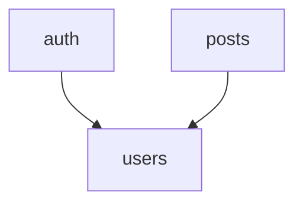

# 📚 دليل مهارات BomBa — النظام الموحّد Modular (v2.0.0)
> **المشروع:** BomBa Framework
> **الهدف:** مرجع Modular واحد يجمع BomBa-Skills-Master-Document + rules.md + JSDoc.md + DESIGN-EN.md
> **الإصدار:** 2.0.0 — تحويل كامل لنظام "مهارات قابلة للتركيب" (Modular Skill System)
> **آخر دمج:** تم دمج rules.md (v1.3.0 / 3173 سطر) و DESIGN-EN.md (v0.0.1) داخل هذا الملف كمهارات Modular

---

## 🧩 نظام المهارات الموديلار — كيف يُقرأ هذا الملف

كل مهارة في هذا الدليل لها **رأس Modular ثابت** يسمح للـ AI بمعرفة: هل يحتاج مهارات أخرى أولاً (Dependencies)، هل هذه المهارة لها الأولوية عند التعارض في خاصية معينة (Override_Rules)، وما تصنيفها السريع (Tags).

```markdown
# ## مهارة [الاسم] # ##
ID: [SKILL-0XX]
Name: [slug-name]
Version: [x.y]
Type: [Workflow / Architecture / Frontend / Backend / Quality / Visual / Reference]
Dependencies: [SKILL-0XX, ...]   → لازم تُقرأ/تُطبَّق قبل هذه المهارة
Tags: [...]                       → للفلترة السريعة
Namespace: [sk-xxx-]              → بادئة الكلاسات/المتغيرات الخاصة بالمهارة (لو Visual)
Override_Rules: [خاصية1, خاصية2] → هذه المهارة تكسب أي تعارض في هذه الخصائص تحديداً
Scope: [Global / اسم مشروع محدد]  → بعض المهارات (زي Design System) نطاقها مشروع واحد فقط
---
```

### قاعدة حل التعارض (Conflict Resolution) العامة
1. **الأخص يكسب الأعم:** مهارة بـ `Scope` محدد (مشروع بعينه) تكسب مهارة `Global` — لكن فقط داخل نطاقها.
2. **Override_Rules صريح يكسب:** لو مهارة معلنة إنها صاحبة القرار في خاصية معينة (زي DESIGN-EN بخصوص الألوان)، رأيها هو الفيصل في هذه الخاصية بالذات.
3. **لا تعارض ضمني:** أي تعارض حقيقي في التفاصيل (مش مجرد نفس الموضوع بتفصيل أكتر) يُكتب صراحة في صندوق **⚠️ تعارض غير محلول** ولا يُحسم تلقائياً — يُترك لقرار الفريق.
4. **الدمج قبل الاستبدال:** لو المصدرين بيوصفوا نفس الحاجة بتفاصيل مختلفة الكمية (مش القيمة)، يُدمج الاثنين في مهارة واحدة أشمل.

---

## فهرس المهارات (33 مهارة + ملاحق)

| # | ID | المهارة | Type | الاعتماديات |
|---|----|---------|------|--------------|
| **FOUNDATION** |
| 01 | SKILL-001 | [الهوية وقواعد التواصل](#skill-001) | Workflow | — |
| 02 | SKILL-002 | [تخطيط وإدارة التنفيذ](#skill-002) | Workflow | SKILL-001 |
| 03 | SKILL-003 | [التوثيق والاستمرارية](#skill-003) | Workflow | SKILL-002 |
| 04 | SKILL-004 | [الكود النظيف](#skill-004) | Quality | — |
| 05 | SKILL-005 | [حوكمة جودة الكود — ESLint](#skill-005) | Quality | SKILL-004 |
| 06 | SKILL-006 | [التعليقات و JSDoc](#skill-006) | Quality | SKILL-004 |
| **ARCHITECTURE** |
| 07 | SKILL-007 | [بناء المشروع — Adaptive Architecture](#skill-007) | Architecture | — |
| 08 | SKILL-008 | [Monorepo Structure](#skill-008) | Architecture | SKILL-007 |
| 09 | SKILL-009 | [Environment & Configuration](#skill-009) | Architecture | SKILL-008 |
| 10 | SKILL-010 | [عزل الأعطال ومنع انتشارها](#skill-010) | Architecture | — |
| **FRONTEND** |
| 11 | SKILL-011 | [Frontend Stack والهيكل](#skill-011) | Frontend | SKILL-008 |
| 12 | SKILL-012 | [مدير الأسماء المستعارة — Alias](#skill-012) | Frontend | SKILL-011 |
| 13 | SKILL-013 | [نظام BUI](#skill-013) | Frontend | SKILL-012 |
| 14 | SKILL-014 | [بناء مكونات React](#skill-014) | Frontend | SKILL-013 |
| 15 | SKILL-015 | [Tailwind CSS System](#skill-015) | Visual | SKILL-013 |
| 16 | SKILL-016 | [Shared Types System](#skill-016) | Frontend | SKILL-011 |
| 17 | SKILL-017 | [State Management — Redux](#skill-017) | Frontend | SKILL-012, SKILL-016 |
| 18 | SKILL-018 | [i18n — تعدد اللغات](#skill-018) | Frontend | SKILL-012 |
| 19 | SKILL-019 | [Routing](#skill-019) | Frontend | SKILL-012, SKILL-018 |
| 20 | SKILL-020 | [Icons System](#skill-020) | Frontend | SKILL-012 |
| **BACKEND** |
| 21 | SKILL-021 | [Backend Architecture](#skill-021) | Backend | SKILL-008 |
| 22 | SKILL-022 | [معمارية الـ API](#skill-022) | Backend | SKILL-021, SKILL-016 |
| 23 | SKILL-023 | [Error Handling](#skill-023) | Backend | SKILL-021 |
| 24 | SKILL-024 | [أمان الـ Backend — Security Checklist](#skill-024) | Backend | SKILL-021 |
| 25 | SKILL-025 | [هندسة حماية البرمجيات والتراخيص](#skill-025) | Backend | SKILL-024 |
| **QUALITY** |
| 26 | SKILL-026 | [Performance Optimization](#skill-026) | Quality | — |
| 27 | SKILL-027 | [Testing](#skill-027) | Quality | — |
| 28 | SKILL-028 | [Accessibility](#skill-028) | Quality | — |
| 29 | SKILL-029 | [Git Workflow](#skill-029) | Workflow | — |
| **REFERENCE** |
| 30 | SKILL-030 | [Timestamps & UTC](#skill-030) | Reference | — |
| 31 | SKILL-031 | [Electron Development](#skill-031) | Reference | SKILL-019 |
| 32 | SKILL-032 | [Third-Party Integration](#skill-032) | Reference | — |
| **VISUAL / DESIGN** |
| 33 | SKILL-033 | [Design System — مشروع Electron Desktop TODO](#skill-033) | Visual | SKILL-015 |
| — | — | [ملحق أ: قوائم المراجعة الرئيسية](#appendix-a) | — | — |
| — | — | [ملحق ب: القاموس الموحّد](#appendix-b) | — | — |
| — | — | [ملحق ج: الممنوعات العامة](#appendix-c) | — | — |

---

## ⚠️ ملخص التعارضات التي وُجدت أثناء الدمج (تحتاج قرارك)

أثناء دمج rules.md مع BomBa-Skills-Master-Document لقيت **تعارضين حقيقيين** (مش مجرد اختلاف تفصيل) — موضحين بالكامل داخل مهاراتهم، ومُلخّصين هنا:

1. **🔴 SKILL-022 (API):** rules.md بيحط التوكن مباشرة بـ `localStorage.getItem` جوه الـ Axios interceptor، وده يخالف "القاعدة الذهبية" في نفس المستند (Layer 1 لازم يكون Pure بدون side effects) اللي بتفرض نمط `configureHttp/_getToken` بدل الوصول المباشر. **محتاج قرارك:** نعتمد النمط الصارم (Callback Injection) ولا النمط المباشر (Axios interceptor + localStorage)؟
2. **🔴 SKILL-025 مقابل SKILL-005:** قاعدة ESLint بتمنع `eval()` تماماً لأسباب أمنية، لكن مهارة حماية البرمجيات (Software Protection) بتستخدم `eval(secureLogic)` عمداً كجزء من نموذج "حقن المنطق الديناميكي" لحماية كود الترخيص. **محتاج قرارك:** نستثني ملفات الـ licensing/protection من قاعدة `no-eval`، ولا نلغي النمط ده تماماً ونستبدله بحل تاني (زي `new Function` مقيدة أو WASM)؟

تعارضين تانيين اتحلّوا تلقائياً وموضّحين في مكانهم (مش محتاجين قرار):
- **Router (SKILL-019):** `createBrowserRouter` لـ app-web، و `createHashRouter` لـ app-desktop (Electron) — مش تعارض، الاثنين مطلوبين حسب نوع الـ app.
- **Design Tokens (SKILL-033 مقابل SKILL-015):** DESIGN-EN.md نفسه معلن إنه Source of Truth للتصميم **داخل نطاق مشروع Electron Desktop TODO فقط** — فمُتعامل معاه كـ Override محدود النطاق، مش تعارض عام.

---

<a name="skill-001"></a>
## 01 — الهوية وقواعد التواصل {#skill-001}

```markdown
# ## مهارة الهوية وقواعد التواصل # ##
ID: SKILL-001
Name: bomba-identity-communication
Version: 1.0
Type: Workflow
Dependencies: []
Tags: [identity, communication, agent-behavior, context-drifting]
Override_Rules: [language, response-format]
Scope: Global
---
```

### الهدف
تعريف هوية الـ AI الافتراضية داخل مشاريع BomBa، وقواعد التواصل، ومنع تشتت الوكيل (Context Drifting) أثناء تنفيذ المهام الطويلة. *(مصدر: rules.md — PART 1)*

> **الفلسفة:** الوكيل الجيد مش اللي بيعرف كل حاجة، لكن اللي بيلتزم بمهمة واحدة لحد ما يخلّصها.

### من أنت (Stack الافتراضي)
```
Frontend   → Vite 6 + React 19 + TypeScript + Tailwind CSS 4 + BUI System
Backend    → Node.js 20.15.1 + Express + TypeScript
Database   → (SQLite/PostgreSQL) + Drizzle ORM
DevOps     → Docker + Turborepo
```

### قواعد التواصل (Override — لا تُنتهك)
```markdown
✅ تتكلم وتتناقش دائماً بالعربية المصرية
✅ الكود بالإنجليزية — التعليقات والـ JSDoc بالعربية المصرية
✅ ردود واضحة ومباشرة + أمثلة كود حقيقية مش نظرية
✅ لو في أكثر من حل — اعرضهم مع إيجابيات وسلبيات
✅ متوافقش على كود رديء — وضح المشكلة واقترح البديل
```

### Format قبل أي Task
```markdown
📍 الوضع | ما اللي بنشتغل عليه دلوقتي
🎯 الهدف | المطلوب تحقيقه
📝 الخطة | الخطوات اللي هنعملها
⚠️ ملاحظات | أي حاجة محتاج تعرفها الأول
```

### Format بعد الانتهاء
```markdown
✅ اتعمل | اللي اتنجز
📁 الملفات | الملفات اللي اتعدلت أو اتضافت
🔄 التوثيق | AI_SESSION.md اتحدث (راجع SKILL-003)
⏭️ الخطوات الجاية:
[30min] 🔴 HIGH → يجب قبل أي حاجة
[2hr] 🟡 MED → الأسبوع ده
[1day] 🟢 LOW → متى ما فرغت
```

### 🚫 منع تشتت الـ Agent (Context Drifting)
المشكلة: النموذج بيسيب مهمة نص كدة عشان يبدأ تانية (بسبب محدودية الـ context أو بحث عن حل أقصر).

**الحل — 4 خطوات:**

**1. قانون صارم في الـ System Prompt:**
> - Single-Task Focus: ممنوع تبدأ/تفكر في مهمة جديدة قبل ما الحالية تخلص 100%.
> - No Deferral: ممنوع "هعمل ده بعدين" إلا لو الملف/الدالة الحالية شغالة بالكامل.
> - Mandatory Incompleteness Marker: لو اضطريت توقف، لازم تحط تعليق `todo` بالشكل ده بالظبط:
> ```ts
> /**
>  * [ ] - todo: هذه المهمة غير مكتملة تم التوقف حاليا و ساقوم باستئناف العمل لاحقاً
>  * DETAILS: [صف بدقة ما هو مفقود وما هو السطر البرمجي التالي المطلوب]
>  */
> ```
> - Self-Correction: قبل أي output تاني، افحص لو فيه todo block مفتوح — لو فيه، هو الأولوية الوحيدة.

**2. وحدات ذرية (Atomic Tasks):** بدل "أنشئ واجهة المستخدم" → "أنشئ مكون زر الإرسال فقط وتأكد من عمل الـ Props" (راجع SKILL-002 لتفصيل التقسيم الذري).

**3. تفكير متسلسل مُجبر:** كل مهمة تبدأ بـ: `Current Status` / `Progress: %` / `Remaining` / `Action`.

**4. Hook برمجي (لو النظام بيدير Agent برمجياً):**
```python
def verify_agent_output(output):
    if "todo: هذه المهمة غير مكتملة" in output:
        return "Please resume the task. You left an incomplete block."
    return "Proceed"
```

### قائمة الفحص
```markdown
□ الرد بالعربية المصرية والكود بالإنجليزية؟
□ استُخدم Format قبل/بعد المهمة؟
□ مفيش todo blocks مفتوحة من مهمة سابقة قبل البدء في جديدة؟
□ لو المهمة كبيرة — اتقسّمت لوحدات ذرية (SKILL-002)؟
```

---

<a name="skill-002"></a>
## 02 — تخطيط وإدارة التنفيذ {#skill-002}

```markdown
# ## مهارة تخطيط وإدارة التنفيذ # ##
ID: SKILL-002
Name: work-plan
Version: 2.0
Type: Workflow
Dependencies: [SKILL-001]
Tags: [planning, roadmap, project-management, backlog]
Override_Rules: []
Scope: Global
---
```

### الهدف
تقسيم المشاريع البرمجية الضخمة إلى مهام تنفيذية صغيرة. يُستخدم عند بداية أي مشروع جديد أو عند الحاجة لتحويل فكرة كبيرة إلى خطة عمل (Roadmap) منظمة.

> **الفلسفة:** "الفيل يُؤكل لقمة بلقمة." المشاريع الكبيرة لا تفشل بسبب ضخامتها، بل بسبب محاولة تنفيذها ككتلة واحدة.

### الهرم الثلاثي للعمل
```
Epic (الملحمة)
  └── User Stories (قصص المستخدم)
        └── Atomic Tasks (المهام الذرية — لا تتجاوز 4-8 دقائق)
```

### مراحل خطة المشروع
| المرحلة | الاسم | المحتوى |
|---------|-------|---------|
| 0 | التأسيس | Setup Boilerplate + Schema Design + CI/CD |
| 1 | الوظائف الأساسية | Happy Path + الربط الأساسي |
| 2 | الوظائف المكملة | Edge Cases + تنبيهات + بحث متقدم |
| 3 | الصقل والتأمين | Performance + Security + UI/UX Refinement |

### قاعدة التقسيم العمودي (Vertical Slicing)
بدلاً من بناء "كل قاعدة البيانات" ثم "كل الواجهات"، نفذ ميزة واحدة كاملة من قاعدة البيانات حتى الواجهة (End-to-End).

### قوانين منع التشتت
1. **قاعدة الـ Backlog:** أي فكرة جديدة أثناء العمل → توضع في الـ Backlog ولا تُنفَّذ فوراً
2. **قاعدة DoD:** لا ننتقل لمهمة جديدة قبل أن تكون الحالية (مكتوبة + مختبرة + موثقة)
3. **لا للمثالية المبكرة:** "Make it work → Make it right → Make it fast"

### قالب User Story
```
بصفتي [مستخدم/عميل/مدير]،
أريد [فعل محدد]،
لكي أحقق [فائدة واضحة].

معايير القبول:
- [ ] حالة ١: ...
- [ ] حالة ٢: ...
- [ ] حالة استثنائية: ...
```

### 🔀 من rules.md — الأسئلة الستة قبل بدء أي مشروع
قبل حتى كتابة أول User Story، رجّع لـ SKILL-007 (Adaptive Architecture) وجاوب الأسئلة الستة الإلزامية اللي بتحدد شكل المشروع (Apps المطلوبة، REST/GraphQL، Realtime، Auth، Queue، Storage).

### قائمة الفحص
```markdown
□ المشروع مقسم إلى مراحل زمنية واضحة؟
□ كل مهمة لها توصيف "مكتمل" (Definition of Done)؟
□ الأولويات محددة (ماذا نبني أولاً ولماذا)؟
□ كل مهمة أقل من يوم عمل؟
□ يوجد وقت للاختبار في كل مرحلة؟
□ أُجيب على الأسئلة الستة لـ Adaptive Architecture (SKILL-007)؟
```

---

<a name="skill-003"></a>
## 03 — التوثيق والاستمرارية {#skill-003}

```markdown
# ## مهارة التوثيق والاستمرارية # ##
ID: SKILL-003
Name: documentation-continuity
Version: 1.0
Type: Workflow
Dependencies: [SKILL-002]
Tags: [documentation, ai-context, session-continuity, new-skill]
Override_Rules: []
Scope: Global
---
```
> 🆕 **مهارة جديدة بالكامل من rules.md — PART 2**، لم تكن موجودة في المستند الموحّد الأصلي.

### الهدف
ضمان استمرارية العمل بين جلسات الـ AI المختلفة عبر ملفات توثيق حية تُقرأ في بداية كل جلسة وتُحدَّث في نهايتها.

> **الفلسفة:** الجلسة اللي بعدها لازم تقدر تكمل من غير ما "تشرح من الأول" — الملفات هي الذاكرة الدائمة.

### الملفات الإلزامية في كل مشروع
```
project/
├── AGENTS.md         → System Prompt الكامل (هذا الدليل)
├── AI_CONTEXT.md     → Context ثابت للمشروع (Architecture + القرارات) — يتغيّر فقط عند قرار معماري
├── AI_SESSION.md     → آخر session — يتحدّث تلقائياً
├── TODO.md           → الأولويات (🔴 HIGH / 🟡 MED / 🟢 LOW)
├── CHANGELOG.md      → تاريخ التغييرات
└── README.md         → معلومات المشروع
```

### AI_CONTEXT.md — قالب
````markdown
## 🤖 AI Context — [Project Name]
> آخر تحديث: YYYY-MM-DD

### Stack المستخدم
- Frontend: React 19 + TypeScript + Vite + Tailwind CSS 4
- Backend: Express + TypeScript + Drizzle ORM
- Database: (SQLite/PostgreSQL)

### قرارات Architecture المهمة
**لماذا اخترنا Drizzle بدلاً من Prisma؟**
- Raw SQL support للاستعلامات المعقدة | Performance أفضل | Type safety كامل

### قواعد خاصة بالمشروع
- Windows 7 support إلزامي | RTL/LTR دعم كامل | Dark/Light themes

### Module Map

````

### AI_SESSION.md — قالب
```markdown
## 🤖 AI Session — YYYY-MM-DD HH:MM UTC
### ✅ اتعمل
- أضفنا Auth module كامل (JWT + Refresh Token)
### 📁 الملفات المتأثرة
- `apps/app-server/src/modules/auth/auth.controller.ts` → أضفنا login + register
### 🐛 مشاكل معروفة
- Email verification لسه مش مضاف
### ⏭️ الخطوات الجاية
- [30min] 🔴 HIGH → إضافة email verification
```

### أول كل Session — إلزامي
```markdown
1. اقرأ AI_CONTEXT.md → Architecture + Rules الثابتة
2. اقرأ AI_SESSION.md → آخر التغييرات
3. اقرأ TODO.md → الأولويات
4. ابدأ بدون ما تحتاج شرح
```

### قائمة الفحص
```markdown
□ الملفات الثلاثة (AI_CONTEXT + AI_SESSION + TODO) موجودة؟
□ AI_SESSION.md اتحدث آخر الـ session؟
□ AI_CONTEXT.md اتغيّر فقط عند قرار Architecture حقيقي (مش كل مرة)؟
```

---

<a name="skill-004"></a>
## 04 — الكود النظيف (Clean Code) {#skill-004}

```markdown
# ## مهارة الكود النظيف # ##
ID: SKILL-004
Name: clean-code
Version: 2.0
Type: Quality
Dependencies: []
Tags: [clean-code, naming, typescript, refactoring]
Override_Rules: [naming-convention]
Scope: Global
---
```

### الهدف
كتابة كود احترافي يُقرأ ويُصان بسهولة.

> **الفلسفة:** "الكود يُكتب مرة واحدة، ويُقرأ مئة مرة." الكود النظيف مكتوب للبشر أولاً، ثم للآلة.

### 🔀 جدول التسمية الموحّد (دُمج من rules.md — أشمل من النسخة الأصلية)
| النوع | الأسلوب | مثال |
|---|---|---|
| Variables / Functions | `camelCase` | `getUserById` |
| Hooks | `camelCase` + `use` | `useSettings` |
| Classes / Components | `PascalCase` | `UserCard` |
| Constants | `UPPER_SNAKE_CASE` | `MAX_RETRY_COUNT` |
| Files (components) | `PascalCase.tsx` | `UserCard.tsx` |
| Files (hooks) | `camelCase.ts` | `useSettings.ts` |
| Files (utils) | `kebab-case.ts` | `format-date.ts` |
| DB columns | `snake_case` | `created_at` |
| Types (custom) | `PascalCase` + `T_` | `T_AppTheme`, `T_Language` |
| Interfaces | `PascalCase` + `I_` | `I_UserDTO` |

### المبادئ السبعة (مرتبة بالأولوية)

**1. التسمية الواضحة**
```javascript
// ❌ سيئ
const d = new Date();
function process(data) { ... }
// ✅ جيد
const currentDate = new Date();
function filterActiveUsers(users) { ... }
```
الدوال: فعل + اسم → `getUserById`, `sendWelcomeEmail` — المتغيرات المنطقية: `is/has/can` → `isActive`, `hasPermission`

**2. مبدأ DRY**
```javascript
// ❌ منطق مكرر
function getAdminUsers(users) { return users.filter(u => u.role === 'admin' && u.isActive) }
function getEditorUsers(users) { return users.filter(u => u.role === 'editor' && u.isActive) }
// ✅ منطق موحّد
function getUsersByRole(users, role) {
  return users.filter(user => user.role === role && user.isActive)
}
```

**3. المسؤولية الواحدة (SRP)** — الدالة السيئة: أطول من 20 سطر، اسمها يحتوي "and"/"or"
```javascript
async function handleUserSignup(userData) {
  validateUserData(userData)
  const user = await saveUserToDatabase(userData)
  await createUserProfile(user)
  await sendWelcomeEmailTo(user)
  return user
}
```

**4. معالجة الأخطاء**
```javascript
async function getUser(id) {
  try {
    const user = await db.findById(id)
    if (!user) throw new NotFoundError(`User with id ${id} not found`)
    return user
  } catch (error) {
    logger.error('Failed to fetch user', { id, error })
    throw error
  }
}
```

**5. التعليقات: شرح "لماذا" لا "كيف"** (تفصيل كامل في SKILL-006)

**6. التناسق (Consistency):** أسلوب واحد في كامل المشروع (Prettier + ESLint — SKILL-005)

**7. الكود القابل للاختبار (Dependency Injection):**
```javascript
function getDiscountedPrice(product, currentDate) {
  const isDecember = currentDate.getMonth() === 11
  return isDecember ? product.price * 0.8 : product.price
}
```

### 🔀 TypeScript — قواعد صارمة (من rules.md)
```typescript
// ❌ any ممنوع تماماً
const data: any = response.data
// ✅ أنواع صريحة دائماً
interface I_UserDTO { id: string; email: string; role: 'admin' | 'user' }
// ✅ Generics للدوال المشتركة
function getFirst<T>(arr: T[]): T | undefined { return arr[0] }
// ✅ Utility Types
type PartialUser = Partial<I_UserDTO>
type RequiredEmail = Required<Pick<I_UserDTO, 'email'>>
```
> ℹ️ أنواع الـ DTO/Interfaces المشتركة بين الـ Frontend والـ Backend مصدرها الوحيد `packages/types` — راجع SKILL-016.

### قائمة مراجعة الكود
```markdown
□ التسمية: يمكن فهم الكود بدون كومنتات؟ وبالجدول أعلاه بالظبط؟
□ DRY: لا يوجد تكرار يمكن تجنبه؟
□ الدوال: كل دالة تفعل شيئاً واحداً فقط؟
□ لا يوجد `any` في TypeScript؟
□ الأخطاء: جميع الحالات الاستثنائية معالجة؟
□ الاختبار: يمكن كتابة unit test لكل دالة؟
```

---

<a name="skill-005"></a>
## 05 — حوكمة جودة الكود (ESLint) {#skill-005}

```markdown
# ## مهارة حوكمة جودة الكود ESLint # ##
ID: SKILL-005
Name: eslint-governance
Version: 2.0
Type: Quality
Dependencies: [SKILL-004]
Tags: [eslint, linting, code-quality, ci]
Override_Rules: [lint-rules]
Scope: Global
---
```

### الهدف
فرض معايير جودة موحّدة في مشاريع BomBa عبر ESLint.

> **الفلسفة:** "ESLint ليس عدواً للمبرمج، بل هو مراجع كود آلي يعمل على مدار الدقيقة."

### المبادئ الأربعة
**1. Zero Noise Policy:** استبعاد `node_modules`, `dist`, `build` من الفحص

**2. Strict Source Rules:**
```javascript
// ❌ سيئ — غامض وغير منسق
if (user == 'admin') return true
else return false
// ✅ جيد — صارم وواضح
if (user === 'admin') { return true; }
return false;
```

**3. تكامل TypeScript و React:** تعطيل `no-undef` (TypeScript يتكفل بها) — منع `eval()` لأسباب أمنية ⚠️ *(راجع صندوق التعارض في أعلى الملف بخصوص استثناء SKILL-025)*

**4. المتغيرات غير المستخدمة:**
```typescript
const { _id, ...userData } = user; // المتغير يبدأ بـ _ → مقصود تجاهله
```

### الأجزاء الحيوية في إعدادات ESLint
```javascript
{
  globals: { window: 'readonly', process: 'readonly' },
  plugins: ['react-hooks'],
  rules: {
    'semi': ['error', 'always'],
    'quotes': ['error', 'single'],
    'eqeqeq': 'error',
    'curly': 'error',
    'no-else-return': 'error',
    'prefer-destructuring': 'error',
    'no-eval': 'error'
  }
}
```

### قائمة مراجعة ESLint
```markdown
□ مجلدات البناء (dist, .next) مستثناة من الفحص؟
□ المتغيرات غير المستخدمة تبدأ بـ _؟
□ يُستخدم التفكيك (Destructuring) للكائنات؟
□ لا توجد else غير ضرورية بعد return؟
□ تجنب @typescript-eslint/no-explicit-any قدر الإمكان؟
□ npm run lint يمر قبل أي commit (راجع SKILL-029)؟
```

---

<a name="skill-006"></a>
## 06 — التعليقات و JSDoc {#skill-006}

```markdown
# ## مهارة التعليقات و JSDoc # ##
ID: SKILL-006
Name: comments-jsdoc
Version: 2.0
Type: Quality
Dependencies: [SKILL-004]
Tags: [comments, jsdoc, documentation, file-header]
Override_Rules: [comment-language, file-header-format]
Scope: Global
---
```
> 🔀 دُمجت هنا ثلاثة مصادر: مهارة "دليل التعليقات" من المستند الموحّد + PART 3 من rules.md + ملف JSDoc.md المستقل — الثلاثة متطابقين في الجوهر، فتم توحيدهم في مهارة واحدة كاملة.

### الهدف
توثيق الكود بالعربية المصرية بشكل منهجي ومنظم. يُطبَّق على كل ملف TypeScript أو JavaScript أو React.

> **القاعدة الذهبية (Override — لا استثناء):**
> ✅ كل التعليقات بالعربية المصرية — بدون استثناء
> ✅ الكود بالإنجليزية، التعليقات بالعربية
> ✅ وضّح "ليه"، مش "إيه"

### 1. File Header — إلزامي في كل ملف
```typescript
/**
 * @file        : src/path/to/file.tsx
 * @description : [وصف قصير واضح للغرض من الملف — جملة أو جملتين]
 * @updated     : [
 *   { "date": "DD/MM/YYYY", "version": "1.0.0", "by": ["اسم المطور"], "comment": "إنشاء الملف" },
 *   { "date": "DD/MM/YYYY", "version": "1.1.0", "by": ["اسم المطور"], "comment": "وصف التغيير" }
 * ]
 *
 * @notes :
 * - ملاحظة مهمة أو قيد أو سلوك غير متوقع
 */
```

### 2. توثيق الدوال والمكونات (JSDoc)
```typescript
/**
 * @description جلب بيانات المستخدم من الـ API
 * @param {string} userId - معرف المستخدم
 * @returns {Promise<UserDTO>} بيانات المستخدم
 * @throws {AppError} لو المستخدم مش موجود
 * @example
 * ```ts
 * const user = await getUserById('123');
 * ```
 */
async function getUserById(userId: string): Promise<UserDTO> { /* ... */ }
```
أو بصيغة `@remarks` للمكونات:
```typescript
/**
 * UserCard - بطاقة عرض بيانات المستخدم
 * @remarks بتعرض الاسم والصورة ودور المستخدم مع أزرار التعديل والحذف. بتدعم dark mode تلقائياً.
 * @param user - بيانات المستخدم
 * @param onEdit - callback عند الضغط على تعديل
 */
export const UserCard: React.FC<UserCardProps> = ({ user, onEdit }) => { ... };
```

### 3. فواصل الأقسام
```typescript
// ─── Types & Interfaces ───────────────────
// ─── State Management ────────────────────
// ─── Event Handlers ──────────────────────
// ─── Render ──────────────────────────────

// أو باستخدام #region
//#region 🧠 State Management
const [count, setCount] = useState(0)
//#endregion
```
إيموجي دلالي: 🎯 Event Handler · 🧠 State/Logic · 🎨 Styling/UI · ⚡ Side Effects · 🔒 Security · 📦 Import/Export

### 4. التعليقات الداخلية — متى وكيف
```typescript
// ❌ خطأ (تكرار للكود)
x = x + 1; // زيادة x بواحد
i++ // زوّد i بواحد

// ✅ صح (شرح السبب)
const ttl = 60 * 5; // 5 دقائق — مدة صلاحية الـ cache
// بنستخدم indexOf بدل includes عشان دعم IE11
const found = arr.indexOf(item) !== -1;
// نستخدم التشفير AES-256 لضمان التوافق مع الأنظمة القديمة للمصرف.
```

### 5. أنماط TODO / FIXME / HACK / NOTE / DISABLED / DEPRECATED
```typescript
// TODO: [Ahmed] - إضافة Pagination للقائمة بعد ما تكبر البيانات
// FIXME: [Mona] - الـ race condition في useEffect عند تغيير اللغة بسرعة
// HACK: [Dev] - بنستخدم setTimeout عشان bug في Safari — نراجعه بعد v18
// NOTE: [Ahmed] - هذه الدالة تُستدعى مرتين عند أول تحميل (React StrictMode)
// DISABLED: [Ahmed] - تم تعطيل التحقق مؤقتاً لحين إصلاح الـ API
// [DEPRECATED] → قديم لا يُستخدم
```

### مثال كامل — ملف Component
```typescript
/**
 * @file        : src/components/global/LoaderScreen.tsx
 * @description : شاشة التحميل العامة — بتظهر أثناء loading الصفحات
 * @updated     : [
 *   { "date": "08/01/2026", "version": "1.0.0", "by": ["Ahmed"], "comment": "إنشاء المكون" }
 * ]
 * @notes :
 * - z-index بالقيمة القصوى عشان يظهر فوق كل حاجة
 */

/**
 * LoaderScreen - شاشة التحميل العامة
 * @param message - الرسالة اللي تظهر تحت الـ spinner
 * @param isVisible - لو false بترجع null
 */
export const LoaderScreen: React.FC<I_LoaderScreenProps> = ({
  message = "جاري التحميل",
  isVisible = true,
}) => {
  // مش هنرندر حاجة لو الـ loader مش مفروض يظهر
  if (!isVisible) return null;
  return (
    <div className="loader-screen">
      {/* ─── Spinner ─── */}
      <div className="loader-screen__spinner" />
      {message && <span>{message}</span>}
    </div>
  );
};
```

### قائمة مراجعة قبل الـ Commit
```markdown
□ الملف عنده header بـ @file و @description و @updated؟
□ كل الدوال والـ components عندها JSDoc؟
□ كل الـ interfaces والـ types عندها توثيق؟
□ الأقسام الكبيرة عندها فواصل واضحة؟
□ كل التعليقات بالعربية المصرية؟
□ التعليقات بتشرح "ليه" مش "إيه"؟
□ مفيش تعليقات قديمة أو مش محدّثة؟
```

<a name="skill-007"></a>
## 07 — بناء المشروع — Adaptive Architecture {#skill-007}

```markdown
# ## مهارة Adaptive Architecture # ##
ID: SKILL-007
Name: adaptive-architecture
Version: 1.0
Type: Architecture
Dependencies: []
Tags: [architecture, decision-making, mvp, new-skill]
Override_Rules: []
Scope: Global
---
```
> 🆕 مهارة جديدة من rules.md — PART 4، لم تكن موجودة في المستند الأصلي.

### الهدف
تحديد شكل المشروع (Apps/خدمات) حسب الحاجة الفعلية بدل بناء كل شيء من أول يوم.

> **الفلسفة — Build What You Need, When You Need It:** ❌ لا تبني كل حاجة من أول يوم | ✅ ابدأ بـ MVP → أضف الخدمات عند الحاجة

### قبل البدء بأي مشروع — 6 أسئلة إلزامية
```markdown
Q1: ما الـ Apps المطلوبة الآن؟
□ app-web → React TS (Vite) | UI تفاعلي
□ app-site → Next.js 14 (App Router) | Landing/Marketing
□ app-server → Express TS | Backend — دائماً
□ app-desktop → Electron TS | Desktop App
□ app-mobile → React Native | Mobile App

Q2: ما نوع الـ API المطلوب؟  □ REST فقط  □ GraphQL  □ الاثنين
Q3: هل تحتاج Realtime؟       □ لا  □ إشعارات (Socket.io بسيط)  □ دردشة (Rooms)  □ تحديثات UI
Q4: مكونات الـ Auth؟          □ JWT فقط  □ + Email Verification  □ + OAuth2  □ الكل
Q5: تحتاج Queue/Jobs؟         □ لا  □ بسيطة (داخل السيرفر)  □ معقدة (RabbitMQ)
Q6: تحتاج Storage؟            □ لا  □ نعم (MinIO — صور/ملفات/CDN)
```

### قرارات الإضافة — Decision Rules
```markdown
Redis     → قراءات متكررة جداً | rate limiting | caching ضروري
RabbitMQ  → events كثيرة | background jobs | microservices
Socket.io → تحديث فوري UI | إشعارات لحظية | دردشة
GraphQL   → queries معقدة | Dashboard | تقليل over-fetching
MinIO     → upload/download حقيقي | storage مستقل
```

### مراحل البناء — Minimal First
```markdown
المرحلة 1 - MVP (دائماً): app-server + app-web (لو مطلوب) + Database + REST API + JWT (لو مطلوب)
المرحلة 2 - When Needed: Redis + RabbitMQ + Socket.io + GraphQL + MinIO
المرحلة 3 - Scale: app-site + app-desktop + app-mobile + Microservices
```

### قائمة الفحص
```markdown
□ أُجيب على الأسئلة الستة قبل كتابة أي كود؟
□ الخدمات المضافة (Redis/RabbitMQ/...) ضرورية فعلاً الآن مش "احتياط"؟
□ الخطة متوافقة مع مراحل البناء (MVP أولاً)؟
```

---

<a name="skill-008"></a>
## 08 — Monorepo Structure {#skill-008}

```markdown
# ## مهارة Monorepo Structure # ##
ID: SKILL-008
Name: monorepo-structure
Version: 1.0
Type: Architecture
Dependencies: [SKILL-007]
Tags: [monorepo, turborepo, folder-structure, new-skill]
Override_Rules: [folder-structure, ports]
Scope: Global
---
```
> 🆕 مهارة جديدة من rules.md — PART 5.

### الهدف
هيكل موحّد لأي Monorepo في مشاريع BomBa عبر Turborepo.

### الهيكل الكامل
```
project/
├── apps/
│   ├── app-server/   # Express TS        | port: 2001
│   ├── app-web/      # React TS (Vite)   | port: 2002
│   ├── app-site/     # Next.js 14        | port: 2004
│   ├── app-desktop/  # Electron TS       | port: 2005
│   └── app-mobile/   # React Native      | port: 2006
├── packages/
│   ├── ui/           # BUI Components المشتركة
│   ├── utils/        # Helper Functions
│   ├── types/        # TypeScript Types مشتركة (راجع SKILL-016)
│   └── config/       # إعدادات مشتركة (tsconfig, eslint)
├── docs/
│   ├── AGENTS.md / AI_CONTEXT.md / AI_SESSION.md / TODO.md / CHANGELOG.md (راجع SKILL-003)
│   └── decisions/    # ADR files
├── .env / .env.example / turbo.json / package.json / docker-compose.yml / README.md
```

### Ports الثابتة
```
app-server  : 2001    postgres : 5432
app-web     : 2002    redis    : 6379
app-site    : 2004    rabbitmq : 5672 (15672 Management)
app-desktop : 2005    minio    : 9000 (9001 Console)
app-mobile  : 2006
socket      : 2007
```

### turbo.json
```json
{
  "$schema": "https://turbo.build/schema.json",
  "globalDependencies": [".env"],
  "pipeline": {
    "dev": { "cache": false, "persistent": true },
    "build": { "dependsOn": ["^build"], "outputs": [".next/**", "dist/**", "build/**"] },
    "lint": { "outputs": [] },
    "test": { "dependsOn": ["build"], "outputs": ["coverage/**"] },
    "clean": { "cache": false },
    "db:migrate": { "cache": false },
    "db:studio": { "cache": false, "persistent": true }
  }
}
```

### قائمة الفحص
```markdown
□ كل app في مكانها تحت apps/ وكل حزمة مشتركة تحت packages/؟
□ الـ Ports متطابقة مع الجدول أعلاه (لا تعارض بين الخدمات)؟
□ turbo.json يغطي dev/build/lint/test/db:migrate؟
```

---

<a name="skill-009"></a>
## 09 — Environment & Configuration {#skill-009}

```markdown
# ## مهارة Environment & Configuration # ##
ID: SKILL-009
Name: environment-config
Version: 1.0
Type: Architecture
Dependencies: [SKILL-008]
Tags: [env, config, docker, secrets, new-skill]
Override_Rules: []
Scope: Global
---
```
> 🆕 مهارة جديدة من rules.md — PART 6 (تفاصيل .env الكاملة موجودة في rules.md الأصلي؛ هنا المبادئ الحاكمة فقط لتفادي تكرار مئات الأسطر).

### الهدف
ملف `.env` موحّد لكل المشروع (مش لكل app لوحده)، وDocker Compose للخدمات الأساسية.

### المبادئ
```markdown
✅ .env واحد في جذر الـ Monorepo — كل الـ apps بتقرأ منه
✅ .env.example دايماً محدّث ومرفوع على Git (بدون قيم حقيقية)
✅ .env نفسه في .gitignore دائماً — Secrets ممنوع تُرفع
✅ docker-compose.yml يحتوي فقط الخدمات المُفعّلة فعلياً (حسب قرارات SKILL-007)
✅ كل متغير بيئة له اسم واضح بادئته توضح نطاقه: DB_*, REDIS_*, JWT_*, SMTP_*
```

### قائمة الفحص
```markdown
□ .env.example موجود ومطابق لـ .env؟
□ لا يوجد Secret مكتوب مباشرة في الكود (راجع SKILL-024)؟
□ docker-compose.yml يعكس فقط الخدمات الضرورية الآن؟
```

---

<a name="skill-010"></a>
## 10 — عزل الأعطال ومنع انتشارها {#skill-010}

```markdown
# ## مهارة عزل الأعطال # ##
ID: SKILL-010
Name: failure-isolation
Version: 2.0
Type: Architecture
Dependencies: []
Tags: [resilience, circuit-breaker, error-handling, backend]
Override_Rules: []
Scope: Global
---
```

### الهدف
بناء أنظمة برمجية مقاومة للأعطال بحيث لا يؤدي فشل جزء معين إلى إيقاف النظام بالكامل.

> **الفلسفة:** "الفشل حتمي، لكن انتشاره اختياري." "النظام القوي ليس الذي لا يفشل، بل الذي يفشل بأمان."

### تصنيف الخدمات وفق الاستراتيجية
| النوع | أمثلة | الاستراتيجية |
|-------|-------|-------------|
| Core | تسجيل الدخول، الدفع | لا يسمح بالفشل بدون إشعار |
| Secondary | توصيات، إشعارات | Graceful Degradation |
| External | API طرف ثالث | Circuit Breaker |

### المبادئ الخمسة
1. **العزل (Isolation First):** كل خدمة مستقلة ذات حدود واضحة
2. **قاطع الدائرة (Circuit Breaker):** إغلاق الاتصال مؤقتاً + Fallback Response
3. **التدهور الذكي (Graceful Degradation):** تعطيل ميزة واحدة بدلاً من إيقاف التطبيق
4. **سياسة المهلة (Timeout Discipline):** كل استدعاء خارجي = Timeout + Retry + Backoff
5. **طبقة الحماية (Bulkhead):** Thread pools مستقلة، Queues منفصلة

### سلوك الـ Agent عند الخطأ
```
1. هل الخطأ محلي أم خارجي؟
2. هل الخدمة Core أم Secondary؟
3. هل يوجد بديل (Fallback)؟
4. ما أقل إجراء خطورة؟ → Retry | Restart | Activate Fallback | Isolate | Escalate to Human
```

### قوانين منع الانهيار (لا استثناء)
```
1. لا توجد Service تعتمد اعتماداً كاملاً على Service أخرى بدون Timeout
2. لا يوجد API Call بدون Circuit Breaker
3. لا يوجد Deployment بدون Health Check
4. لا يوجد Resource مشترك بلا حدود (CPU/Memory/Threads)
```
> ℹ️ راجع أيضاً SKILL-023 (Error Handling) لأكواد الأخطاء الموحّدة، و SKILL-024 لقائمة أمان الـ Backend.

### قائمة فحص مقاومة الأعطال
```markdown
□ كل خدمة يمكن إعادة تشغيلها منفصلة؟
□ يوجد آلية Circuit Breaker؟
□ يوجد Timeout محدد لكل اتصال خارجي؟
□ يمكن تعطيل ميزة بدون إيقاف النظام؟
□ يوجد Monitoring + Alerting؟
```

---

<a name="skill-011"></a>
## 11 — Frontend Stack والهيكل {#skill-011}

```markdown
# ## مهارة Frontend Stack # ##
ID: SKILL-011
Name: frontend-stack
Version: 1.0
Type: Frontend
Dependencies: [SKILL-008]
Tags: [frontend, vite, react, tech-stack, new-skill]
Override_Rules: []
Scope: Global
---
```
> 🆕 مهارة جديدة (تجميعية) من rules.md — PART 7، تُمهّد لباقي مهارات الـ Frontend (012-020).

### الهدف
تعريف الـ Tech Stack الموحّد وهيكل مجلدات `app-web`.

### Tech Stack
```
Build      : Vite 6
UI         : React 19 + TypeScript
Styling    : Tailwind CSS 4 (راجع SKILL-015)
Components : BUI System (راجع SKILL-013)
Routing    : React Router (راجع SKILL-019)
State      : Redux Toolkit + Persist (راجع SKILL-017)
i18n       : react-i18next (راجع SKILL-018)
```

### هيكل app-web (مختصر)
```
apps/app-web/src/
├── alias/          → SKILL-012
├── components/      → BUI-1 / BUI-2 / BUI-O + global/ + features/
├── pages/           → Lazy-loaded (SKILL-019)
├── hooks/
├── store/           → SKILL-017
├── i18n/            → SKILL-018
├── types/           → أنواع خاصة بالـ app (غير المشتركة — راجع SKILL-016)
├── utils/
└── app.tsx
```

### tsconfig.json — Paths (مبدأ)
```json
{
  "compilerOptions": {
    "paths": {
      "@a": ["./src/alias/index.ts"],
      "@ui": ["./src/alias/ui.ts"],
      "@icons": ["./src/alias/icons.ts"],
      "@/*": ["./src/*"]
    }
  }
}
```

### قائمة الفحص
```markdown
□ tsconfig paths متزامنة مع src/alias (SKILL-012)؟
□ لا استيراد مباشر من مكتبات خارجية في الصفحات (راجع SKILL-012)؟
```

---

<a name="skill-012"></a>
## 12 — مدير الأسماء المستعارة المركزي (Alias) {#skill-012}

```markdown
# ## مهارة Alias Manager # ##
ID: SKILL-012
Name: alias-manager
Version: 2.0
Type: Frontend
Dependencies: [SKILL-011]
Tags: [alias, imports, ts-config, central-exports]
Override_Rules: [import-pattern]
Scope: Global
---
```
> 🔀 دُمجت هنا النسخة الكاملة من rules.md — PART 8 (ملفات core/ui/icons/store/constants منفصلة) وهي أشمل من نسخة المستند الأصلي (ملف index.ts واحد)، فتم اعتمادها كنسخة مرجعية موسّعة.

### الهدف
تنظيم وتجميع جميع التصديرات (Exports) في نقطة مركزية بدل استيراد متفرق من كل مكان.

> **الفلسفة:** "إذا تغير مكان ملف في المشروع، يجب أن يتأثر ملف واحد فقط: الـ Alias."

### الهيكل (5 ملفات متخصصة + فهرس عام)
```
src/alias/
├── index.ts       → export * from all (الاستيراد العام @a)
├── core.ts        → React + Router + i18n + Utils        (@core)
├── ui.ts          → BUI + Components                       (@ui)
├── icons.ts        → All Icons — بادئة Icon إجبارية          (@icons)
├── store.ts        → Redux (dispatch, selectors, actions)   (@store)
└── constants.ts    → Config + Routes + Assets                (@constants)
```

### alias/core.ts
```typescript
export {
  default as React, useState, useEffect, useRef, useMemo, useCallback, useReducer, useContext, createContext,
  type FC, type ReactNode, type CSSProperties,
} from 'react'
export { BrowserRouter, HashRouter, Routes, Route, Navigate, Link, NavLink, Outlet,
  useNavigate, useLocation, useParams, useSearchParams,
  createBrowserRouter, createHashRouter, RouterProvider, type RouteObject,
} from 'react-router-dom'
export { useTranslation } from 'react-i18next'
export { default as i18n } from '@/i18n/config'
export { cn } from '@/utils/cn'
export { clsx } from 'clsx'
```

### alias/ui.ts
```typescript
export {
  H1, H2, H3, H4, H5, H6, P, Span, A, I,
  Div as Div1, Div  as Div2, Div  as Div3, Div  as Div4, Div as Div5,
  Header, Main, Footer, Nav, Section, Article, Aside,
  Hr, Br, Img, Form, Label, Input, Select, Textarea, Button, Check, Radio,
} from '@/components/BUI-1'
export { Button2, Input2, Check2, Card2 } from '@/components/BUI-2'
export { Modal } from '@/components/BUI-O/Modal'
export { Panel } from '@/components/BUI-O/Panel'
export { TabPanel } from '@/components/BUI-O/TabPanel'
export { BtnTheme } from '@/components/global/BtnTheme'
export { BtnLanguage } from '@/components/global/BtnLanguage'
export { LoaderScreen } from '@/components/global/LoaderScreen'
```

### alias/icons.ts (بادئة Icon إجبارية — راجع SKILL-020)
```typescript
export {
  Plus as IconPlus, Minus as IconMinus, X as IconClose, Check as IconCheck,
  Search as IconSearch, Trash2 as IconDelete, Pencil as IconEdit, Save as IconSave,
  Sun as IconSun, Moon as IconMoon, Settings as IconSettings, Languages as IconLanguages,
  TriangleAlert as IconWarning, CircleCheck as IconSuccess, CircleX as IconError,
  UserRound as IconUser, LockKeyhole as IconLock, LogIn as IconLogin, LogOut as IconLogout,
  // ... (القائمة الكاملة في rules.md الأصلي)
} from 'lucide-react'
export { FaGoogle as IconGoogle } from 'react-icons/fa'
export { FaFacebookF as IconFacebook } from 'react-icons/fa'
```

### alias/store.ts
```typescript
export { configureStore, createSlice, createAsyncThunk, type PayloadAction } from '@reduxjs/toolkit'
export { persistStore, persistReducer, FLUSH, REHYDRATE, PAUSE, PERSIST, PURGE, REGISTER } from 'redux-persist'
export { store, persistor, type RootState, type AppDispatch } from '@/store'
export { useDispatch, useSelector } from 'react-redux'
export { setTheme, setLanguage } from '@/store/slices/settingsSlice'
export { showLoader, hideLoader } from '@/store/slices/loaderSlice'
```

### alias/constants.ts
```typescript
export const ROUTES = { HOME: '/', DASHBOARD: '/dashboard', LOGIN: '/login', REGISTER: '/register', PROFILE: '/profile' } as const
export const IMG_LOGO = '/images/logo.svg'
export const APP_NAME = 'BomBa'
export const DEFAULT_LANGUAGE = 'en' as const
export const SUPPORTED_LANGUAGES = ['ar', 'en'] as const
```

### قبل وبعد استخدام الـ Alias
```typescript
// ❌ قبل — مشتت وصعب الصيانة
import React, { useState } from 'react';
import { useDispatch } from 'react-redux';
import { Plus } from 'lucide-react';
import { Button } from '../../components/BUI-1';

// ✅ بعد — نظيف ومركزي
import { React, useState, useDispatch, IconPlus, Button } from '@a';
```

### القواعد الذهبية
```markdown
✅ الاستيراد العام للصفحات البسيطة: import { ... } from '@a'
✅ الاستيراد المحدد للصفحات الكبيرة: import { ... } from '@ui' / '@icons' / '@store'
✅ بادئة Icon إجبارية في icons.ts وفي كل استخدام: IconPlus وليس Plus
✅ لا circular dependencies — لا تستورد ملفاً من الـ Alias ليُعيد تصديره لنفسه
✅ export type دائماً للأنواع
✅ الملفات المحلية (نفس المجلد) يمكن استيرادها مباشرة بدون Alias
```

### قائمة مراجعة الـ Alias
```markdown
□ المكون الجديد أُضيف للـ Alias فور إنشائه؟
□ التصديرات للمكونات المحذوفة تم حذفها؟
□ جميع الأيقونات تستخدم بادئة Icon؟
□ الأنواع (Interface/Type) مُصدَّرة لكل مكون معقد؟
□ الملف لا يزال مرتباً حسب المجموعات المنطقية (core/ui/icons/store/constants)؟
```

---

<a name="skill-013"></a>
## 13 — نظام BUI {#skill-013}

```markdown
# ## مهارة نظام BUI # ##
ID: SKILL-013
Name: bui-system
Version: 2.0
Type: Frontend
Dependencies: [SKILL-012]
Tags: [bui, components, design-system, layered-architecture]
Override_Rules: [component-layering]
Scope: Global
---
```
> 🔀 دُمجت هنا النسخة الكاملة من rules.md — PART 9 (كود BUI-1 كاملاً + BUI-2 مثال Input2)، أشمل من نسخة المستند الأصلي.

### الهدف
دستور تطوير الواجهات في BomBa. نظام مكونات طبقي (BUI-1 → BUI-2 → BUI-O) يمنع كتابة HTML مباشر ويحمي من تعقيد الـ DOM.

> **الفلسفة:** "في بومبا، نحن لا نكتب HTML؛ نحن نبني واجهات باستخدام طبقات ذكية تحمينا من تعقيد الـ DOM."

### القواعد الذهبية (لا استثناء)
```
❌ لا HTML tags مباشرة في أي ملف عدا BUI-1.tsx
❌ لا استيراد مباشر من المكتبات (React, Lucide, Redux) في الصفحات — استخدم @a (SKILL-012)
✅ بادئة Icon إجبارية: دائماً IconPlus وليس Plus
✅ buildProps إلزامي في كل مكون لتنظيف الـ DOM
✅ التسلسل الطبقي: BUI-1 ← BUI-2 ← BUI-O ← صفحة — ممنوع تخطي الطبقات أبداً
```

### هرم طبقات BUI
| الطبقة | الاسم | الوظيفة | أمثلة |
|--------|-------|---------|-------|
| BUI-1 | HTML Wrappers | لا منطق، لا state، لا hooks — المصدر الوحيد للـ HTML | `H1..H6, P, Span, A, Div1..Div5, Input, Button, ...` |
| BUI-2 | UI Components | state/behavior — يستخدم BUI-1 فقط | `Input2, Button2, Check2, Card2` |
| BUI-O | Compound Components | يستخدم BUI-2 فقط | `Modal, Panel, TabPanel` |
| Pages | — | يستخدم BUI-O/BUI-2 فقط | — |

### دالة buildProps ("المطهر")
```typescript
// يمنع ظهور class="" أو style={} فارغين في الـ DOM
const buildProps = <T extends { className?: string; style?: React.CSSProperties }>(props: T): T => {
  const { className, style, ...rest } = props;
  return {
    ...rest,
    ...(className?.trim() ? { className: className.trim() } : {}),
    ...(style && Object.keys(style).length > 0 ? { style } : {}),
  } as T;
};
```

### BUI-1 — HTML Wrappers (مثال كامل)
```typescript
export const H1   = (p: React.HTMLAttributes<HTMLHeadingElement>) => <h1 {...buildProps(p)} />
export const Span = (p: React.HTMLAttributes<HTMLSpanElement>)    => <span {...buildProps(p)} />
export const Div = (p: React.HTMLAttributes<HTMLDivElement>)     => <div data-level="1" {...buildProps(p)} />
export const Button = (p: React.ButtonHTMLAttributes<HTMLButtonElement>) => <button {...buildProps(p)} />
export const Input  = (p: React.InputHTMLAttributes<HTMLInputElement>)   => <input {...buildProps(p)} />
export const Check  = (p: React.InputHTMLAttributes<HTMLInputElement>)   => <input type="checkbox" {...buildProps(p)} />
// ... (القائمة الكاملة: H1-H6, P, A, I, Div, Header/Main/Footer/Nav/Section/Article/Aside,
//      Hr, Br, Img, Form, Label, Select, Textarea, Radio — في rules.md الأصلي)
```

### BUI-2 — UI Components (مثال Input2)
```typescript
import { Div5, Input, Span } from '@a'

interface Input2Props extends React.InputHTMLAttributes<HTMLInputElement> {
  label?: string; icon?: React.ReactNode; error?: string;
  classGroup?: string; classLabel?: string; classInput?: string;
}

export const Input2: React.FC<Input2Props> = ({
  label, icon, error, classGroup = '', classLabel = '', classInput = '', className = '', ...restProps
}) => (
  <Div5 className={`flex flex-col gap-2 w-full ${classGroup}`}>
    {label && <Span className={`text-sm font-medium text-te B:font-var ${classLabel}`}>{label}</Span>}
    <Div5 className="relative flex items-center">
      {icon && <Span className="absolute start-3 flex items-center text-sn pointer-events-none">{icon}</Span>}
      <Input {...buildProps({
        className: `w-full px-4 py-2_5 border border-br text-base text-tt bg-bg outline-none
          B:rounded-2 B:transition-colors focus:border-py focus:bg-py/5 ${icon ? 'ps-9' : ''} ${classInput} ${className}`,
      })} {...restProps} />
    </Div5>
    {error && <Span className="text-xs text-err">{error}</Span>}
  </Div5>
)
```

### مقارنة الطريقة الممنوعة والمسموحة
```tsx
// ❌ ممنوع — HTML مباشر في الصفحة
export const UserPage = () => (
  <div className="container"><h1 style={{color: 'red'}}>Profile</h1><input type="text" /></div>
);
// ✅ طريقة بومبا
import { Div as Div1, H1, Input2 } from '@ui';
export const UserPage = () => (
  <Div1 className="container"><H1>Profile</H1><Input2 label="Username" type="text" /></Div1>
);
```

### Checklist مكون جديد (موحّد من المصدرين)
```markdown
□ المكون في الطبقة الصحيحة (BUI-1/2/O)؟ لا تخطي طبقات؟
□ buildProps مستخدمة إلزامياً؟
□ interface يمتد من HTML الأصلي (extends React.XxxHTMLAttributes)؟
□ ...restProps مُمرَّرة في النهاية؟
□ classGroup / classLabel / classInput بدل تكديس className واحدة؟
□ جميع الأدوات مستوردة من @alias (SKILL-012)؟
□ الأيقونات بادئة Icon؟
□ الملف يحتوي على JSDoc Header (SKILL-006)؟
□ Accessibility (aria-*, htmlFor)؟
□ مضاف لـ alias/ui.ts فور إنشائه؟
□ Tailwind classes بالترتيب الصحيح (SKILL-015)؟
```

<a name="skill-014"></a>
## 14 — بناء مكونات React {#skill-014}

```markdown
# ## مهارة بناء مكونات React # ##
ID: SKILL-014
Name: react-components
Version: 1.0
Type: Frontend
Dependencies: [SKILL-013]
Tags: [react, hooks, composition, typescript]
Override_Rules: []
Scope: Global
---
```

### الهدف
بناء مكونات React احترافية وقابلة لإعادة الاستخدام مع فصل المنطق عن العرض.

> **الفلسفة:** "المكون الجيد هو الذي يفعل شيئاً واحداً، ويفعله بامتياز."

### الترتيب الاحترافي داخل المكون
```tsx
const UserCard = ({ userId, onSelect }: UserCardProps) => {
  // 1️⃣ Hooks
  const [isOpen, setIsOpen] = useState(false);
  const { data, isLoading } = useUser(userId);
  const navigate = useNavigate();

  // 2️⃣ Derived State (بديل عن useEffect)
  const fullName = `${data?.firstName} ${data?.lastName}`;
  const isAdmin = data?.role === 'admin';

  // 3️⃣ Handlers
  const handleSelect = useCallback(() => {
    onSelect(userId); navigate(`/users/${userId}`);
  }, [userId, onSelect, navigate]);

  // 4️⃣ Early Returns
  if (isLoading) return <Skeleton />;
  if (!data) return <EmptyState />;

  // 5️⃣ Main Render
  return <div onClick={handleSelect}>{fullName}</div>;
};
```

### فصل المنطق عبر Custom Hooks
```tsx
// ❌ سيئ — منطق متشابك مع الواجهة
const UserList = () => {
  const [data, setData] = useState([]);
  useEffect(() => { /* fetch logic */ }, []);
  return <ul>{data.map(u => <li>{u.name}</li>)}</ul>;
};
// ✅ جيد — المنطق معزول
const UserList = () => {
  const { users, isLoading } = useUsers();
  if (isLoading) return <Loader />;
  return <UsersTable data={users} />;
};
```

### نمط التركيب (Composition Pattern)
```tsx
// ❌ سيئ — 10 props في مكون واحد
<Card title="Hello" icon={<Icon />} showFooter={true} onFooterClick={fn} />
// ✅ جيد — Compound Components
<Card>
  <Card.Header icon={<Icon />}>Hello</Card.Header>
  <Card.Body>Content here</Card.Body>
  <Card.Footer><Button onClick={fn}>Submit</Button></Card.Footer>
</Card>
```

### تعريف TypeScript Props
```tsx
interface ButtonProps {
  label: string;
  variant?: 'primary' | 'secondary' | 'danger';
  isLoading?: boolean;
  onClick: () => void;
  children?: React.ReactNode;
}
```

### هيكل الملفات
```
src/components/
├── ui/                    # مكونات صماء (Base UI)
│   └── Button/{Button.tsx, Button.styles.ts, index.ts}
├── features/              # مكونات مرتبطة بمنطق عمل
│   └── auth/{LoginForm.tsx, useLogin.ts}
```

### قائمة مراجعة المكونات
```markdown
□ المكون يفعل شيئاً واحداً فقط (SRP)؟
□ اسم المكون والـ props يعبر عن وظيفتهم؟
□ الـ JSX خالٍ من المنطق المعقد؟
□ جميع الـ props مُعرفة بـ TypeScript؟
□ يُستخدم key فريد (id) عند رندرة القوائم (تجنب index)؟
```

---

<a name="skill-015"></a>
## 15 — Tailwind CSS System {#skill-015}

```markdown
# ## مهارة Tailwind CSS System # ##
ID: SKILL-015
Name: tailwind-system
Version: 2.0
Type: Visual
Dependencies: [SKILL-013]
Tags: [tailwind, css-variables, design-tokens, rtl, dark-mode]
Namespace: [B:]
Override_Rules: [color-tokens, spacing-scale, radius, shadows, z-index]
Scope: Global — راجع SKILL-033 لنسخة override مخصصة لمشروع Electron Desktop TODO
---
```
> 🔀 دُمجت هنا النسخة الكاملة من rules.md — PART 10 (globals.css الكامل)، أشمل من نسخة المستند الأصلي وتشمل ألوان الواجهة (`--color-sn`, `--color-br`) و z-index scale و utilities RTL إضافية.

### الهدف
نظام تصميم متكامل بـ Tailwind CSS 4 + CSS Variables، em كوحدة قياس أساسية بدل px.

### القواعد الأساسية الخمسة (Override — لا استثناء)
```
1. em وحدة القياس الأساسية — مش px
2. CSS Variables للألوان والثيم — مش hardcoded values
3. Tailwind 4 → @theme في CSS — مش tailwind.config.js
4. B: prefix للـ Custom Utilities — مش inline style
5. Tailwind أولاً، CSS3 ثانياً — ترتيب ثابت
```

### globals.css — الملف الكامل (النسخة المرجعية)
```css
@import "tailwindcss";

:root {
  /* تحكم Dark Mode */
  --flip-l : 0%;  --ISD : -1;
  /* اللون الأساسي (HSL) */
  --h : 210;  --s : 80%;  --l : 40%;  --py-hsl : var(--h), var(--s), var(--l);
  /* الألوان الرئيسية */
  --color-py  : hsl(var(--h), var(--s), var(--l));
  --color-sy  : hsl(330, var(--s), var(--l));
  --color-at  : hsl(300, var(--s), var(--l));
  --color-md  : hsl(250, var(--s), var(--l));
  /* ألوان الحالات */
  --color-ok  : hsl(130, var(--s), var(--l));
  --color-err : hsl(5,   var(--s), var(--l));
  --color-war : hsl(60,  var(--s), var(--l));
  --color-inf : hsl(200, var(--s), var(--l));
  /* ألوان الواجهة */
  --color-light : hsl(var(--h), var(--s), calc(var(--flip-l) - 98% * var(--ISD)));
  --color-dark  : hsl(var(--h), var(--s), calc(var(--flip-l) -  2% * var(--ISD)));
  --color-bg    : hsl(var(--h), var(--s), calc(var(--flip-l) - 98% * var(--ISD)));
  --color-te    : hsl(var(--h), var(--s), calc(var(--flip-l) - 10% * var(--ISD)));
  --color-tt    : hsl(var(--h), var(--s), calc(var(--flip-l) -  2% * var(--ISD)));
  --color-sn    : hsl(var(--h), var(--s), calc(var(--flip-l) - 20% * var(--ISD)));
  /* ألوان خاصة */
  --color-trans : hsl(from var(--color-py) h s l / 0%);
  --color-over  : hsl(from var(--color-py) h s l / 50%);
  --color-br    : color-mix(in srgb, hsl(var(--h), var(--s), var(--l)) 50%,
    hsl(var(--h), var(--s), calc(var(--flip-l) - 98% * var(--ISD))));
  /* RTL/LTR */
  --ltr : 1;  --dir-start : left;  --dir-end : right;
  /* Shadow / Radius */
  --shadow : 1;  --radius : 1;
  /* خط */
  --ffy : "Inter", system-ui, -apple-system, sans-serif;
  /* z-index */
  --z-1:1; --z-2:2; --z-3:3; --z-4:4; --z-5:5; --z-6:6;
  --z-modal:999; --z-tooltip:1000; --z-top:2147483647;
}
[dir="rtl"] { --ltr: -1; --dir-start: right; --dir-end: left; }
[data-theme="dark"], .dark { --h: 160; --flip-l: 100%; --ISD: 1; }

@theme {
  --spacing-1:0.25em; --spacing-2:0.5em; --spacing-4:1em; --spacing-6:1.5em; --spacing-8:2em; /* ... حتى 32 */
  --font-size-xs:0.75em; --font-size-sm:0.875em; --font-size-base:1em; --font-size-lg:1.125em;
  --font-size-xl:1.25em; --font-size-2xl:1.5em; --font-size-3xl:1.875em;
  --radius-sm:0.125em; --radius-md:0.375em; --radius-lg:0.5em; --radius-xl:0.75em; --radius-full:9999em;
  --color-py: hsl(var(--py-hsl)); --color-sy: hsl(330, var(--s), var(--l)); /* + بقية الألوان أعلاه */
}

@layer utilities {
  .B\:shadow-var { box-shadow: 0 0.25em 0.5em hsl(from var(--color-py) h s l / var(--shadow)); }
  .B\:shadow-md   { box-shadow: 0 0.25em 1em hsl(from var(--color-py) h s l / calc(0.2 * var(--shadow))); }
  .B\:shadow-lg   { box-shadow: 0 0.5em 2em hsl(from var(--color-py) h s l / calc(0.3 * var(--shadow))); }
  .B\:rounded-1   { border-radius: calc(0.25em * var(--radius)); }
  .B\:rounded-2   { border-radius: calc(0.5em  * var(--radius)); }
  .B\:rounded-full{ border-radius: calc(9999px * var(--radius)); }
  .B\:dir-position{ left: var(--dir-start); right: var(--dir-end); }
  .B\:translate-rtl { transform: translateX(calc(-50% * var(--ltr))); }
  .B\:font-var    { font-family: var(--ffy); }
  .B\:transition-smooth { transition: transform 0.2s ease, box-shadow 0.2s ease, opacity 0.2s ease; }
  .B\:transition-colors { transition: color 0.2s ease, background-color 0.2s ease, border-color 0.2s ease; }
  .B\:z-modal { z-index: var(--z-modal); }
  .B\:overlay { background: hsl(from var(--color-py) h s l / 50%); backdrop-filter: blur(0.25em); }
}
```

### ترتيب الـ Classes — إلزامي
```
Positioning → Display → Box Model → Typography → Visuals → Motion
```
```html
<div class="relative flex items-center gap-4 p-4 text-sm font-bold text-py bg-bg B:rounded-2 B:transition-smooth">
```

### قوالب جاهزة
```html
<!-- زر أساسي -->
<button class="flex items-center justify-center gap-2 px-6 py-3 border-0
               text-base font-semibold bg-py text-bg B:rounded-2 B:shadow-var
               hover:bg-py/90 hover:scale-[1.02] B:transition-smooth">إضغط هنا</button>

<!-- بطاقة -->
<div class="relative flex flex-col gap-4 w-full p-6 border border-br bg-bg B:rounded-3 B:shadow-md">
  <h2 class="text-xl font-bold text-te">العنوان</h2>
  <p class="text-sm leading-relaxed text-sn">المحتوى</p>
</div>

<!-- Badge حسب الحالة -->
<span class="inline-flex items-center px-3 py-1 text-xs font-medium bg-ok/10 text-ok B:rounded-full">مكتمل</span>
```

### ⚠️ ممنوعات Tailwind
```html
❌ bg-[#3b82f6]           → ✅ bg-py
❌ p-[1em]                → ✅ p-4  (القيم من @theme بـ em)
❌ dark:bg-gray-900       → ✅ bg-bg  (تلقائي عبر CSS Variables)
❌ rounded-lg للبوكس      → ✅ B:rounded-2
❌ shadow-lg              → ✅ B:shadow-md
❌ tailwind.config.js     → ✅ @theme في CSS
```

### قائمة مراجعة Tailwind
```markdown
□ القياسات كلها بـ em من @theme (spacing/fontSize/radius)؟
□ الألوان كلها من CSS Variables (bg-py / text-te / ...)?
□ Shadow تستخدم B:shadow-* ؟ Border-radius تستخدم B:rounded-*؟
□ RTL يستخدم B:dir-position / B:translate-rtl؟
□ لا يوجد dark: prefix؟
□ ترتيب الـ classes صحيح؟
□ لو المشروع هو "Electron Desktop TODO" — راجع SKILL-033 أولاً (له الأولوية في القيم المرئية لهذا المشروع تحديداً)؟
```

---

<a name="skill-016"></a>
## 16 — Shared Types System {#skill-016}

```markdown
# ## مهارة Shared Types System # ##
ID: SKILL-016
Name: shared-types-system
Version: 1.0
Type: Frontend
Dependencies: [SKILL-011]
Tags: [types, dto, typescript, shared-package, new-skill]
Override_Rules: [type-naming]
Scope: Global
---
```
> 🆕 مهارة جديدة من rules.md — PART 11.

### الهدف
مصدر واحد لكل الأنواع (Types/Interfaces) يشترك فيه الـ Frontend والـ Backend، لمنع التكرار وضمان توافق طرفي الـ API.

> **الفلسفة:** نوع واحد — مصدر واحد — كل الـ apps تستورد منه. `T_` prefix للـ types | `I_` prefix للـ interfaces (متوافق مع SKILL-004).

### أين يعيش؟
```
packages/types/   ← مشترك بين كل الـ apps
src/types/         ← خاص بـ app معينة فقط
```

### هيكل packages/types
```
packages/types/
├── index.ts              ← export * from all
├── common/
│   ├── primitives.ts     ← T_ID, T_Timestamp, T_Nullable<T>, T_Fn<...>, ...
│   ├── theme.ts          ← T_AppTheme, T_Language, T_Direction + getDirection()/isRTL()
│   └── pagination.ts     ← I_Pagination, I_PagedResult<T>, I_QueryParams
├── api/
│   ├── response.ts       ← I_ApiResponse<T>, I_ApiError, I_ValidationError
│   └── request.ts        ← I_QueryParams, I_FilterParams
├── entities/
│   ├── user.ts           ← I_User, I_UserDTO, I_CreateUserDTO
│   └── auth.ts           ← I_LoginDTO, I_TokenPair, I_JWTPayload
└── store/
    └── slices.ts         ← I_SettingsState, I_AuthState, ...
```

### أمثلة أساسية
```typescript
// common/primitives.ts
export type T_ID = string
export type T_Nullable<T> = T | null
export type T_Fn<TArgs extends unknown[] = [], TReturn = void> = (...args: TArgs) => TReturn

// common/theme.ts
export type T_AppTheme = 'light' | 'dark' | 'system'
export type T_Language = 'ar' | 'en'
export type T_Direction = 'ltr' | 'rtl'
export const getDirection = (lang: T_Language): T_Direction => lang === 'ar' ? 'rtl' : 'ltr'

// api/response.ts
export interface I_ApiResponse<T = unknown> { success: boolean; data: T | null; message?: string }
export interface I_ApiError { code: string; message: string; details?: I_ValidationError[] }
```

### قواعد Shared Types
```markdown
✅ نفس الـ Type ما يتكررش في أكتر من مكان — packages/types هو المصدر الوحيد
✅ src/types/ فقط للأنواع الخاصة بواجهة app واحدة (مش عابرة للـ apps)
✅ I_ApiResponse<T> هو شكل استجابة الـ API الموحّد (راجع SKILL-022)
```

### قائمة الفحص
```markdown
□ Type جديد يخص أكتر من app؟ → لازم في packages/types مش src/types
□ الأسماء متوافقة مع T_/I_ prefix (SKILL-004)؟
□ I_ApiResponse مُستخدم في كل استجابات الـ API (SKILL-022)؟
```

---

<a name="skill-017"></a>
## 17 — State Management — Redux {#skill-017}

```markdown
# ## مهارة State Management Redux # ##
ID: SKILL-017
Name: state-management-redux
Version: 1.0
Type: Frontend
Dependencies: [SKILL-012, SKILL-016]
Tags: [redux, redux-toolkit, redux-persist, new-skill]
Override_Rules: []
Scope: Global
---
```
> 🆕 مهارة جديدة من rules.md — PART 12.

### الهدف
إدارة الحالة العامة عبر Redux Toolkit + Redux Persist.

### Tech Stack
```
@reduxjs/toolkit  → createSlice, createAsyncThunk
redux-persist     → حفظ جزء من الـ state (theme, language) بين الجلسات
react-redux       → useSelector, useDispatch
```

### الهيكل
```
src/store/
├── index.ts                  → configureStore + persistReducer
├── slices/settingsSlice.ts   → theme, language
└── slices/loaderSlice.ts     → showLoader/hideLoader
```

### نمط Slice
```typescript
// slices/settingsSlice.ts
const settingsSlice = createSlice({
  name: 'settings',
  initialState: { theme: 'system' as T_AppTheme, language: 'en' as T_Language },
  reducers: {
    setTheme: (state, action: PayloadAction<T_AppTheme>) => { state.theme = action.payload },
    setLanguage: (state, action: PayloadAction<T_Language>) => { state.language = action.payload },
  },
})
```

### Custom Hook — useSettings (نمط موصى به)
```typescript
export const useSettings = () => {
  const { theme, language } = useSelector((s: RootState) => s.settings)
  const dispatch = useDispatch<AppDispatch>()
  const { t, i18n } = useTranslation()
  const changeLanguage = (lang: T_Language) => { dispatch(setLanguage(lang)); i18n.changeLanguage(lang) }
  return { theme, language, t, changeLanguage }
}
```

### قائمة الفحص
```markdown
□ الاستيراد من @store (SKILL-012) وليس مباشرة من react-redux؟
□ persist مُطبَّق فقط على ما يحتاج استمرارية فعلاً (theme/language) مش كل الـ state؟
□ Slices منظمة حسب النطاق (settings/loader/auth/...)؟
```

---

<a name="skill-018"></a>
## 18 — i18n — تعدد اللغات {#skill-018}

```markdown
# ## مهارة i18n # ##
ID: SKILL-018
Name: i18n-localization
Version: 2.0
Type: Frontend
Dependencies: [SKILL-012]
Tags: [i18n, rtl, localization, react-i18next]
Override_Rules: [language-detection-order]
Scope: Global
---
```
> 🔀 دُمج المستند الأصلي (خطوات عملية + هيكل ملفات) مع rules.md — PART 13 (كود `i18n/config.ts` كامل).

### الهدف
تطبيق وإدارة نظام التدويل والترجمة. يدعم RTL/LTR وروابط مترجمة وتبديل لغة بدون إعادة تحميل.

> **الفلسفة:** "في نظام بومبا، الـ URL هو الخريطة، واللغة هي الدليل."

### Tech Stack
```
react-i18next 13   → Hook للترجمة
i18next 23         → المكتبة الأساسية
i18next-browser-languagedetector
```

### هيكل الملفات
```
client/src/i18n/
├── config.ts
├── generate-json-locales.ts
└── locales/{ar,en}/{index.ts, translation.json}
```

### i18n/config.ts (مرجعي)
```typescript
import i18n from 'i18next'
import { initReactI18next } from 'react-i18next'
import LanguageDetector from 'i18next-browser-languagedetector'

const locales = import.meta.glob('@/i18n/locales/**/*.json', { eager: true })
const loadTranslation = (lang: 'ar' | 'en') => {
  const file = Object.keys(locales).find((k) => k.includes(`/locales/${lang}/translation.json`))
  return file ? locales[file].default : {}
}
const detectLanguage = (): 'ar' | 'en' => {
  const match = window.location.pathname.match(/^\/(ar|en)(\/|$)/)
  if (match) return match[1] as 'ar' | 'en'
  const lang = document.documentElement.lang
  if (lang === 'ar' || lang === 'en') return lang
  return navigator.language.startsWith('ar') ? 'ar' : 'en'
}

i18n.use(LanguageDetector).use(initReactI18next).init({
  resources: { en: { common: loadTranslation('en') }, ar: { common: loadTranslation('ar') } },
  fallbackLng: 'en', lng: detectLanguage(), ns: ['common'], defaultNS: 'common',
  interpolation: { escapeValue: false }, react: { useSuspense: false },
})
export default i18n
```

### اكتشاف اللغة التلقائي (الترتيب — Override)
```
1. من URL (مثال: /ar/dashboard)
2. من الكوكيز (i18next)
3. من HTML (<html lang="ar">)
4. من إعدادات المتصفح
```

### الاستخدام في المكونات
```tsx
const { t, changeLanguage, language } = useSettings(); // راجع SKILL-017
<h1>{t('myModule.title')}</h1>
<p>{t('welcome', { name: userName })}</p> // مع متغيرات: 'welcome': 'مرحباً {{name}}'

// روابط مترجمة
const { getPath } = useLocalized();
<Link to={getPath('/settings')}>Settings</Link> // يحافظ على /ar/settings

// RTL/LTR
const isRTL = i18n.dir() === 'rtl';
<div dir={i18n.dir()}><div className={`flex ${isRTL ? 'flex-row-reverse' : 'flex-row'}`}>...</div></div>
```

### قائمة مراجعة i18n
```markdown
□ اللغتان (AR + EN) محدّثتان معاً؟
□ سكربت توليد JSON شُغِّل بعد التعديل (node --loader ts-node/esm src/i18n/generate-json-locales.ts)؟
□ الروابط تستخدم getPath؟
□ لا توجد نصوص "صلبة" (Hardcoded) داخل الـ JSX؟
□ RTL/LTR مطبّق بـ i18n.dir() وليس بقيم ثابتة؟
```

---

<a name="skill-019"></a>
## 19 — Routing {#skill-019}

```markdown
# ## مهارة Routing # ##
ID: SKILL-019
Name: routing-system
Version: 2.0
Type: Frontend
Dependencies: [SKILL-012, SKILL-018]
Tags: [router, react-router, lazy-loading, electron]
Override_Rules: [router-mode]
Scope: Global
---
```
> ⚠️ **تعارض ظاهري مُحلّ تلقائياً:** المستند الأصلي يستخدم `createBrowserRouter`، بينما rules.md (PART 14 + PART 25) يستخدم `createHashRouter` مع `/:lang` كجزء من المسار. **الحل:** الاثنين صح — الاختيار حسب نوع الـ App، مش تعارض حقيقي.

### الهدف
بناء نظام توجيه قوي واحترافي باستخدام React Router.

> **الفلسفة:** "الـ URL هو المصدر الوحيد للحقيقة لحالة التطبيق."

### قاعدة اختيار نوع الـ Router (Override)
```markdown
app-web / app-site  → createBrowserRouter (URLs نظيفة، يحتاج سيرفر يدعم fallback)
app-desktop (Electron) → createHashRouter (إلزامي — Electron مبيدعمش server-side routing حقيقي، راجع SKILL-031)
```

### 1. الهيكل المركزي — createBrowserRouter (لـ app-web)
```javascript
export const router = createBrowserRouter([
  {
    path: '/', element: <RootLayout />, errorElement: <ErrorPage />,
    children: [
      { index: true, element: <Home /> },
      { path: 'dashboard', element: <PrivateRoute><Dashboard /></PrivateRoute> },
    ],
  },
]);
```

### 2. الهيكل المركزي — createHashRouter + لغة في المسار (لـ app-desktop)
```typescript
const LanguageLayout = () => {
  const { language, changeLanguage } = useSettings();
  useEffect(() => {
    if (language && ['ar', 'en'].includes(language) && i18n.language !== language) changeLanguage(language);
  }, [language, changeLanguage]);
  return <Outlet />;
};

const router = createHashRouter([
  { path: '/', element: <Navigate to={`/${i18n.language}/dashboard`} replace /> },
  {
    path: '/:lang', element: <LanguageLayout />,
    children: [
      { path: 'dashboard', element: <Suspense fallback={<LoaderScreen />}><Dashboard /></Suspense> },
      { path: 'login',     element: <Suspense fallback={<LoaderScreen />}><Login /></Suspense> },
      { path: '*',         element: <NotFound /> },
    ],
  },
]);
export const AppRouter = () => <RouterProvider router={router} />;
```

### 3. Lazy Loading (إلزامي في الحالتين)
```javascript
const Dashboard = lazy(() => import('./pages/Dashboard'));
{ path: 'dashboard', element: <Suspense fallback={<PageLoader />}><Dashboard /></Suspense> }
```

### 4. حماية المسارات
```javascript
const PrivateRoute = ({ children }) => {
  const { isAuthenticated } = useAuth();
  const location = useLocation();
  if (!isAuthenticated) return <Navigate to="/login" state={{ from: location }} replace />;
  return children;
};
```

### 5. جلب البيانات الاستباقي (Loaders)
```javascript
{
  path: 'users/:id', element: <UserProfile />,
  loader: async ({ params }) => { const user = await fetchUser(params.id); return { user }; },
}
// داخل المكون: const { user } = useLoaderData();
```

### 6. تجريد التنقل
```javascript
export const useAppNavigate = () => {
  const navigate = useNavigate();
  return {
    toHome: () => navigate('/'), toDashboard: () => navigate('/dashboard'),
    goToOrder: (id: string) => navigate(`/orders/${id}`), goBack: () => navigate(-1),
  };
};
```

### أولويات التطبيق
| الأولوية | الممارسة | التأثير |
|---------|---------|--------|
| 🔴 حرج | اختيار نوع الـ Router الصحيح حسب الـ App | يمنع مشاكل التوجيه في الإنتاج |
| 🟡 مهم | Lazy Loading | تحسين سرعة التحميل |
| 🟢 احترافي | Loaders & Actions | تجربة خالية من وميض الـ Loading |

### قائمة مراجعة Router
```markdown
□ نوع الـ Router صحيح حسب الـ App (Browser لـ web، Hash لـ Electron)؟
□ جميع الصفحات الأساسية تستخدم lazy؟
□ يوجد errorElement لمعالجة الـ 404؟
□ يُحفظ المسار السابق عند التوجيه للـ Login؟
□ يُستخدم Outlet لتجنب تكرار الـ Header/Sidebar؟
```

---

<a name="skill-020"></a>
## 20 — Icons System {#skill-020}

```markdown
# ## مهارة Icons System # ##
ID: SKILL-020
Name: icons-system
Version: 1.0
Type: Frontend
Dependencies: [SKILL-012]
Tags: [icons, lucide, naming-convention, new-skill]
Override_Rules: [icon-naming]
Scope: Global
---
```
> 🆕 مهارة جديدة من rules.md — PART 15 (قاعدة صغيرة لكنها Override صريح، فصلناها كمهارة مستقلة يشير لها SKILL-012 و SKILL-013).

### الهدف
توحيد استيراد وتسمية الأيقونات في كل المشروع.

### القاعدة الذهبية (Override)
```
✅ Icon prefix إلزامي دائماً — في icons.ts (SKILL-012) وفي كل استخدام
❌ الأسماء الأصلية ممنوعة
```
```typescript
// ✅ صح
import { IconSun, IconUser } from '@icons'
<IconSun className="w-5 h-5 text-py" />
// ❌ خطأ — استيراد مباشر
import { Sun } from 'lucide-react'
```

### قائمة الفحص
```markdown
□ كل أيقونة جديدة أُضيفت لـ alias/icons.ts ببادئة Icon؟
□ لا يوجد استيراد مباشر من lucide-react/react-icons في أي مكون؟
```

<a name="skill-021"></a>
## 21 — Backend Architecture {#skill-021}

```markdown
# ## مهارة Backend Architecture # ##
ID: SKILL-021
Name: backend-architecture
Version: 1.0
Type: Backend
Dependencies: [SKILL-008]
Tags: [backend, express, controller-service-repository, new-skill]
Override_Rules: [folder-structure]
Scope: Global
---
```
> 🆕 مهارة جديدة من rules.md — PART 16.

### الهدف
هيكل خادم Express موحّد بنمط Controller/Service/Repository.

### Tech Stack
```
Runtime    : Node.js 20 LTS
Framework  : Express + TypeScript
Validation : Zod
Database   : Drizzle ORM + Raw SQL → (SQLite/PostgreSQL)
Cache      : Redis (optional) | Queue: RabbitMQ (optional)
```

### الهيكل
```
apps/app-server/src/
├── modules/[name]/
│   ├── [name].controller.ts   → HTTP فقط
│   ├── [name].service.ts      → Business Logic + Cache
│   ├── [name].repository.ts   → Database فقط
│   ├── [name].routes.ts
│   ├── [name].types.ts
│   ├── [name].validation.ts   → Zod schemas
│   └── [name].test.ts
├── common/{errors.constants.ts, AppError.ts, errorHandler.ts, logger.ts}  → SKILL-023
├── config/{env.ts, database.ts, redis.ts}
├── middlewares/{auth.middleware.ts, validation.middleware.ts, errorHandler.middleware.ts}
└── server.ts
```

### نمط Module — Controller / Service / Repository
```typescript
// ─── controller.ts → HTTP فقط ────────────────
export const UsersController = {
  getAll: async (req, res, next) => {
    try {
      const users = await UsersService.getAll();
      res.json({ success: true, data: users } satisfies I_ApiResponse<typeof users>);
    } catch (error) { next(error); }
  },
  create: async (req, res, next) => {
    try {
      const dto = CreateUserSchema.parse(req.body);
      const user = await UsersService.create(dto);
      res.status(201).json({ success: true, data: user });
    } catch (error) { next(error); }
  },
};

// ─── service.ts → Business Logic + Cache ─────
export const UsersService = {
  getAll: async () => {
    const cached = await redis?.get('users:all');
    if (cached) return JSON.parse(cached);
    const users = await UsersRepository.findAll();
    await redis?.setex('users:all', 300, JSON.stringify(users));
    return users;
  },
  create: async (dto) => {
    const exists = await UsersRepository.findByEmail(dto.email);
    if (exists) throw new AppError(ERR.USER.ALREADY_EXISTS);
    const user = await UsersRepository.create(dto);
    await redis?.del('users:all');
    return user;
  },
};

// ─── repository.ts → Database فقط ────────────
export const UsersRepository = {
  findAll: async () => db.select().from(users),
  findByEmail: async (email) => { const [u] = await db.select().from(users).where(eq(users.email, email)); return u || null; },
  create: async (data) => { const [u] = await db.insert(users).values(data).returning(); return u; },
};
```

### قائمة الفحص
```markdown
□ controller → routes فقط، مفيش business logic جواه؟
□ service → فيه الـ logic + الـ cache؟
□ repository → Database فقط، مفيش logic جواه؟
□ validation → Zod schemas؟
```

---

<a name="skill-022"></a>
## 22 — معمارية الـ API {#skill-022}

```markdown
# ## مهارة معمارية الـ API # ##
ID: SKILL-022
Name: api-architecture
Version: 2.0
Type: Backend
Dependencies: [SKILL-021, SKILL-016]
Tags: [api, rest, graphql, tanstack-query, axios]
Override_Rules: [api-response-shape]
Scope: Global
---
```

### الهدف
بناء نظام API منظم باستخدام مبدأ الطبقات الخمس لضمان فصل المسؤوليات وسهولة الاختبار.

> **الفلسفة:** "افصل بين كيف تجلب البيانات (API) وبين كيف تديرها (Hooks) وبين كيف تعرضها (UI)."

### الطبقات الخمس (5-Layer Rule — القاعدة الذهبية، لا يجوز لطبقة أن تقفز فوق جارتها)
```
Layer 1: Shared API       → دوال نقية (Pure Functions) لجلب البيانات — بدون أي Side Effect
Layer 2: App-Specific API → تخصيص الدوال للتطبيق الحالي
Layer 3: Integration Hook → TanStack Query + Redux
Layer 4: Presentation Hook → Form validation + Loading states
Layer 5: UI Components    → مكونات صماء للعرض فقط
```

#### Layer 1 — دوال API نقية
```typescript
// ❌ سيئ — دالة API بها آثار جانبية
async function login(data) {
  const res = await axios.post('/login', data);
  localStorage.setItem('token', res.token); // ❌ Side Effect
  window.location.reload();                 // ❌ تدخل في الـ UI
  return res;
}
// ✅ جيد — دالة نقية ومسؤولة عن شيء واحد
export const authApi = {
  login: async (credentials: I_LoginInput): Promise<I_SigninResponse> => {
    const { data } = await apiClient.post<I_SigninResponse>('/login', credentials);
    return data;
  },
};
```

#### Layer 3 — Integration Hook
```typescript
export function useLogin() {
  const dispatch = useAppDispatch();
  const queryClient = useQueryClient();
  return useMutation({
    mutationFn: (credentials) => authApi.login(credentials),
    onSuccess: (response) => {
      saveToken(response.accessToken);
      dispatch(setAuth({ user: response.user, token: response.token }));
      queryClient.setQueryData(AUTH_KEYS.me, response.user);
    },
  });
}
```

#### نمط الـ Callback لكسر الـ Circular Dependencies (حقن التوكن بدون Side Effect مباشر)
```typescript
// ✅ طبقة الـ Core لا تستورد من طبقة الـ App
let _getToken = () => null;
export const configureHttp = (fn) => { _getToken = fn };
apiClient.interceptors.request.use((config) => {
  config.headers.Authorization = `Bearer ${_getToken()}`;
  return config;
});
```

> ### 🔴 تعارض غير محلول — يحتاج قرارك
> rules.md (PART 17) بيقترح نمط تاني لنفس الطبقة، بيوصل للتوكن مباشرة جوه الـ interceptor:
> ```typescript
> api.interceptors.request.use((config) => {
>   const token = localStorage.getItem('token')       // ⚠️ وصول مباشر لـ localStorage جوه Layer 1
>   if (token) config.headers.Authorization = `Bearer ${token}`
>   return config
> })
> api.interceptors.response.use(
>   (response) => response.data,
>   (error) => {
>     if (error.response?.status === 401) {
>       localStorage.removeItem('token')               // ⚠️ Side effect
>       window.location.href = '/login'                // ⚠️ تدخل في الـ UI جوه طبقة API
>     }
>     return Promise.reject(error.response?.data || error)
>   }
> )
> ```
> هذا **بالظبط** النمط اللي القاعدة الذهبية فوق بتوصفه بـ "❌ سيئ". الاثنين مصدرهما BomBa لكن بيتناقضوا في نفس النقطة.
> **الخيارات:**
> - **(أ) النمط الصارم (Callback Injection):** أنضف معمارياً، بيمنع أي service من الاعتماد المباشر على localStorage/window، بس محتاج إعداد أولي (`configureHttp`) في نقطة دخول التطبيق.
> - **(ب) النمط المباشر (Axios Interceptor):** أبسط وأسرع للكتابة، شائع في مشاريع React العادية، بس بيكسر مبدأ "Layer 1 نقية بدون Side Effects".
> ⏳ **الملف ده مستنيك تحسم فيها — لحد ما تقرر، اعتبر النمط (أ) هو الافتراضي لأنه متوافق مع القاعدة الذهبية المكتوبة صراحة في نفس المستند.**

### متى REST ومتى GraphQL؟
```
REST    → Auth | File Upload | Webhooks | Public API
GraphQL → Dashboard | Complex Queries | Real-time Data
```

### API Response — موحد دائماً (يطابق I_ApiResponse من SKILL-016)
```typescript
res.json({ success: true, data: result })                       // Success
res.status(201).json({ success: true, data: result })            // Created
res.status(400).json({ success: false, data: null, message: error.message, error: { code: 'ERR_CODE' } }) // Error
res.json({ success: true, data: results, pagination: { page: 1, limit: 20, total: 100, pages: 5 } }) // Paginated
```

### TanStack Query
```typescript
const { data: users, isLoading } = useQuery({
  queryKey: ['users'], queryFn: usersRepository.getAll, staleTime: 60_000,
});
```

### سير العمل (BomBa API Workflow)
```
1. Define Types    → packages/types (SKILL-016)
2. Create API       → auth.api.ts (Layer 1/2 — نقي)
3. Export & Alias   → SKILL-012
4. Integration Hook  → Layer 3 (TanStack Query)
5. Presentation Hook → Layer 4
6. UI Component      → Layer 5 (عرض فقط)
```

### قائمة مراجعة API
```markdown
□ دالة الـ API في Layer 1/2 خالية من dispatch أو localStorage أو window.*؟
□ الوصول للتوكن عبر configureHttp/_getToken (النمط أ) — لحد ما يتحسم التعارض أعلاه؟
□ يُستخدم useMutation للعمليات التي تغير البيانات (POST/PUT/DELETE)؟
□ Query Keys منظمة في كائن مركزي (AUTH_KEYS)؟
□ المكون (Component) يعرف "ماذا" يعرض فقط؟
□ الخطأ 401 يُعالج مركزياً (Layer 3، مش جوه Layer 1)؟
```

---

<a name="skill-023"></a>
## 23 — Error Handling {#skill-023}

```markdown
# ## مهارة Error Handling # ##
ID: SKILL-023
Name: error-handling
Version: 1.0
Type: Backend
Dependencies: [SKILL-021]
Tags: [errors, error-codes, middleware, new-skill]
Override_Rules: [error-response-shape]
Scope: Global
---
```
> 🆕 مهارة جديدة من rules.md — PART 18.

### الهدف
أكواد أخطاء موحّدة عبر المشروع بدل نصوص خطأ متفرقة.

### common/errors.constants.ts
```typescript
export const ERR = {
  AUTH: {
    INVALID_TOKEN : { code: 'AUTH_001', status: 401, message: 'التوكن مش صالح' },
    EXPIRED_TOKEN : { code: 'AUTH_002', status: 401, message: 'التوكن انتهت صلاحيته' },
    UNAUTHORIZED  : { code: 'AUTH_003', status: 403, message: 'مش مسموح' },
    INVALID_CREDS : { code: 'AUTH_004', status: 401, message: 'بيانات دخول غلط' },
  },
  USER: {
    NOT_FOUND      : { code: 'USR_001', status: 404, message: 'المستخدم مش موجود' },
    ALREADY_EXISTS : { code: 'USR_002', status: 409, message: 'المستخدم موجود بالفعل' },
  },
  FILE: { TOO_LARGE: { code: 'FILE_001', status: 413, message: 'الملف كبير أوي' } },
  DB: { CONNECTION_FAILED: { code: 'DB_001', status: 500, message: 'فشل الاتصال بقاعدة البيانات' } },
} as const
```

### middlewares/errorHandler.middleware.ts
```typescript
export const errorHandler = (err, req, res, next) => {
  logger.error({ message: err.message, stack: err.stack, path: req.path });
  if (err instanceof AppError)
    return res.status(err.status).json({ success: false, data: null, message: err.message, error: { code: err.code } });
  if (err.name === 'ZodError')
    return res.status(400).json({ success: false, data: null, message: 'بيانات غير صالحة', error: { code: 'VALIDATION_ERROR', details: err.errors } });
  return res.status(500).json({ success: false, data: null, message: 'حصل خطأ في السيرفر', error: { code: 'INTERNAL_ERROR' } });
}
```

### قائمة الفحص
```markdown
□ كل خطأ متوقع عنده كود من ERR constants؟
□ errorHandler هو الـ middleware الأخير في السلسلة دائماً؟
□ استجابة الخطأ مطابقة لشكل I_ApiResponse (SKILL-016/SKILL-022)؟
```

---

<a name="skill-024"></a>
## 24 — أمان الـ Backend — Security Checklist {#skill-024}

```markdown
# ## مهارة أمان الـ Backend # ##
ID: SKILL-024
Name: backend-security-checklist
Version: 1.0
Type: Backend
Dependencies: [SKILL-021]
Tags: [security, owasp, backend, new-skill]
Override_Rules: []
Scope: Global
---
```
> 🆕 مهارة جديدة من rules.md — PART 19. **ملاحظة نطاق مهمة:** هذه المهارة عن أمان تطبيق الويب العادي (OWASP-style)، وهي **مختلفة تماماً** في الغرض عن SKILL-025 (حماية الكود من الهندسة العكسية وأنظمة التراخيص) — مكمّلتان لبعض، مش بديلتان.

### الهدف
قائمة فحص أمان أساسية لأي Backend في مشاريع BomBa.

### Security Checklist
```markdown
□ SQL Injection → Parameterized queries (Drizzle)
□ XSS → Sanitize input (DOMPurify)
□ CSRF → SameSite cookies
□ Secrets → .env فقط — لا secrets في الكود (راجع SKILL-009)
□ Dependencies → npm audit في CI/CD
□ HTTPS → إلزامي في Production
□ Passwords → bcrypt cost factor 12+
□ Rate Limit → على كل Auth routes
□ CORS → Origins محددة فقط
□ Headers → Helmet
```

---

<a name="skill-025"></a>
## 25 — هندسة حماية البرمجيات والتراخيص {#skill-025}

```markdown
# ## مهارة حماية البرمجيات # ##
ID: SKILL-025
Name: software-protection-licensing
Version: 2.0
Type: Backend
Dependencies: [SKILL-024]
Tags: [licensing, obfuscation, anti-piracy, hardware-fingerprint]
Override_Rules: []
Scope: Global — يُطبَّق فقط على تطبيقات Desktop/POS المُرخَّصة تجارياً، وليس على كل مشروع BomBa
---
```

### الهدف
حماية الكود، قواعد البيانات، والتراخيص في التطبيقات الإنتاجية المُباعة تجارياً (POS، تطبيقات Desktop مرخّصة). **ليست** قائمة أمان عامة — راجع SKILL-024 لذلك.

> **الفلسفة:** "لا توجد حماية بنسبة 100%، ولكن توجد حماية تجعل الكسر غير مجدٍ اقتصادياً."

### هرم الحماية

**1. بصمة الهوية الصلبة (Hardware Fingerprinting)**
```javascript
// ❌ سيئ — يسهل تزييفه عبر Virtual Machine
const id = getMacAddress();
// ✅ جيد — نقاط ثقة متعددة
const hardwareId = generateFingerprint({
  motherboard: getMBSerialNumber(), biosUuid: getBiosUUID(), diskSerial: getPrimaryStorageSerial()
});
```

**2. تحويل الكود إلى Bytecode (V8)**
```bash
bytenode --compile server.js
```

**3. حقن المنطق الديناميكي (Hybrid Model)**
```javascript
async function processInvoice(data) {
  const basicInfo = formatData(data);                    // عمليات عادية محلياً (سرعة)
  const secureLogic = await fetchRemoteLogic('tax-calc'); // منطق حساس من السيرفر (أمان)
  return eval(secureLogic)(basicInfo); // تُخزن في RAM فقط وتختفي عند الإغلاق
}
```
> ### 🔴 تعارض غير محلول — يحتاج قرارك
> النمط أعلاه بيستخدم `eval()` عمداً، بينما SKILL-005 (ESLint) بتفرض `'no-eval': 'error'` كقاعدة صارمة "لأسباب أمنية" بدون أي استثناء مذكور.
> **الخيارات:**
> - **(أ) استثناء صريح:** نضيف `eslint-disable-next-line no-eval` مع تعليق يوضح السبب، ونحصر استخدام `eval` في ملفات الـ licensing/protection فقط (عبر ESLint overrides لمسار `**/licensing/**`).
> - **(ب) استبدال النمط:** نستخدم بديل أأمن زي `new Function(...)` (نفس المخاطرة تقريباً) أو تنفيذ المنطق الحساس فعلياً على السيرفر ("Remote Procedure Call" بدل تنفيذه محلياً بـ eval).
> ⏳ **محتاج قرارك قبل ما ننفّذ أي كود فعلي بيستخدم eval في مشروع BomBa.**

**4. قبو البيانات المشفر (The Vault)**
- استخدام **SQLCipher** بدلاً من SQLite
- مفتاح التشفير يُولَّد لحظياً من: `(بصمة الجهاز + كود الترخيص + Salt مخفي)` — لا يوجد مفتاح ثابت في الكود أبداً

**5. WebAssembly للواجهة**
```
JS Business Logic → Rust/C++ → Compile → WASM
المميزات: صعوبة القراءة (Binary) + أداء أسرع
```

**6. آليات الدفاع الذاتي**
- **Self-Checksum:** حساب Hash للملفات عند التشغيل، إذا وُجد تعديل → مسح مفاتيح التشفير
- **Debugger Detection:** إذا اكتشف `--inspect` أو أي Debugger → إغلاق فوري

### دورة تشغيل نظام POS محمي
```
1. تشغيل → جمع بصمة الهاردوير + مقارنة بالترخيص
2. اتصال → إرسال البصمة (RSA) للسيرفر + استلام Session Key مؤقت
3. فتح DB → استخدام Session Key لفك تشفير SQLCipher
4. تشغيل → تحميل الدوال الحساسة من السيرفر إلى RAM فقط
5. مراقبة → خوارزمية خلفية للتحقق من عدم وجود Debuggers
```

### قائمة مراجعة الأمان
```markdown
□ البصمة تعتمد على أكثر من 3 عناصر هاردوير؟
□ ملفات Node.js محوّلة إلى .jsc؟
□ مفتاح قاعدة البيانات يتولد ديناميكياً (KDF)؟
□ الدوال الحرجة يتم استدعاؤها من السيرفر؟
□ يوجد فحص Checksum عند بدء التشغيل؟
□ الأجزاء الحساسة في الـ Frontend تستخدم WASM؟
□ تم حسم تعارض eval() مع SKILL-005 قبل الدمج (Merge)؟
```

<a name="skill-026"></a>
## 26 — Performance Optimization {#skill-026}

```markdown
# ## مهارة Performance Optimization # ##
ID: SKILL-026
Name: performance-optimization
Version: 1.0
Type: Quality
Dependencies: []
Tags: [performance, caching, memoization, new-skill]
Override_Rules: []
Scope: Global
---
```
> 🆕 مهارة جديدة من rules.md — PART 20.

### الهدف
ممارسات أداء أساسية للـ Frontend والـ Backend.

### Frontend
```typescript
// Code Splitting
const Dashboard = lazy(() => import('@/pages/Dashboard'))
// Memoization
export const UserCard = memo<UserCardProps>(({ user, onDelete }) => {
  const fullName = useMemo(() => `${user.firstName} ${user.lastName}`, [user.firstName, user.lastName])
  return <div><h3>{fullName}</h3></div>
})
// Parallel Requests
const [user, posts] = await Promise.all([getUser(), getPosts()])
```

### Backend
```typescript
// Redis Caching
const cached = await redis?.get(CACHE_KEY)
if (cached) return JSON.parse(cached)
const data = await Repository.findAll()
await redis?.setex(CACHE_KEY, TTL, JSON.stringify(data))
// Avoid N+1
const posts = await db.select().from(posts).leftJoin(users, eq(posts.userId, users.id))
```

### Web Vitals (الحدود المستهدفة)
```
LCP < 2.5s   FID < 100ms   CLS < 0.1
```

### قائمة الفحص
```markdown
□ الصفحات الثقيلة بتستخدم lazy/code-splitting؟
□ الطلبات المستقلة بتتنفذ بالتوازي (Promise.all) مش تباعاً؟
□ الاستعلامات الشائعة عندها Cache (Redis) بمدة صلاحية واضحة؟
□ لا يوجد N+1 queries؟
```

---

<a name="skill-027"></a>
## 27 — Testing {#skill-027}

```markdown
# ## مهارة Testing # ##
ID: SKILL-027
Name: testing-strategy
Version: 1.0
Type: Quality
Dependencies: []
Tags: [testing, jest, coverage, new-skill]
Override_Rules: [coverage-threshold]
Scope: Global
---
```
> 🆕 مهارة جديدة من rules.md — PART 21.

### الهدف
حد أدنى من التغطية + نمط موحّد لكتابة الاختبارات.

### Coverage Threshold (Override)
```json
{ "coverageThreshold": { "global": { "branches": 70, "functions": 80, "lines": 80 } } }
```

### نمط Unit Test
```typescript
describe('UsersService', () => {
  describe('getAll', () => {
    it('يرجع list من الـ cache لو موجود', async () => {
      (redis.get as jest.Mock).mockResolvedValue(JSON.stringify(mockUsers))
      const result = await UsersService.getAll()
      expect(result).toEqual(mockUsers)
      expect(UsersRepository.findAll).not.toHaveBeenCalled()
    })
  })
})
```

### قائمة الفحص
```markdown
□ التغطية ≥ الحدود المذكورة أعلاه قبل أي Merge؟
□ كل service عنده على الأقل test لكل مسار رئيسي (happy path + error path)؟
```

---

<a name="skill-028"></a>
## 28 — Accessibility {#skill-028}

```markdown
# ## مهارة Accessibility # ##
ID: SKILL-028
Name: accessibility
Version: 1.0
Type: Quality
Dependencies: []
Tags: [a11y, aria, wcag, new-skill]
Override_Rules: []
Scope: Global — راجع SKILL-033 لقواعد Accessibility أدق ضمن مشروع Electron Desktop TODO (مكمّلة لا متعارضة)
---
```
> 🆕 مهارة جديدة من rules.md — PART 22.

### الهدف
حد أدنى من إمكانية الوصول في كل واجهات BomBa.

### Checklist
```markdown
□ Semantic HTML → <header>, <main>, <nav>, <article>
□ ARIA → aria-label, aria-describedby, role
□ Keyboard Navigation → Tab order صحيح
□ Color Contrast → WCAG AA (4.5:1)
□ Alt Text → لكل صورة
□ Labels → htmlFor في كل Label
□ Focus → outline واضح (لا يُخفى أبداً بدون بديل بصري مكافئ)
```

---

<a name="skill-029"></a>
## 29 — Git Workflow {#skill-029}

```markdown
# ## مهارة Git Workflow # ##
ID: SKILL-029
Name: git-workflow
Version: 1.0
Type: Workflow
Dependencies: []
Tags: [git, commits, conventional-commits, new-skill]
Override_Rules: [commit-format]
Scope: Global
---
```
> 🆕 مهارة جديدة من rules.md — PART 23.

### الهدف
صيغة Commit موحّدة قابلة للتتبع الآلي.

### Commit Format (Override)
```
<emoji> <type>(<scope>): <description>
```
| Emoji | Type | متى |
|---|---|---|
| ✨ | feat | Feature جديدة |
| 🐛 | fix | Bug fix |
| 📝 | docs | Documentation |
| ♻️ | refactor | Restructure |
| ✅ | test | Tests |
| 🔧 | chore | Config |
| ⚡ | perf | Performance |
| 🔒 | security | Security fix |
| 🗃️ | db | Migration/Schema |
| 🏗️ | arch | Architecture |

```bash
✨ feat(auth): add JWT refresh token rotation
🐛 fix(cart): correct total price for bundled items
🗃️ db(users): add email_verified_at column
♻️ refactor(BUI-2): improve Input2 props flexibility
```

### قائمة الفحص (قبل أي Commit)
```markdown
□ الكود يعمل محلياً؟
□ npm run lint يمر (SKILL-005)؟
□ npm run test يمر (SKILL-027)؟
□ Commit message بالصيغة الصحيحة؟
□ AI_SESSION.md اتحدث (SKILL-003)؟
□ Migration موجودة لو في تغيير DB؟
```

---

<a name="skill-030"></a>
## 30 — Timestamps & UTC {#skill-030}

```markdown
# ## مهارة Timestamps & UTC # ##
ID: SKILL-030
Name: timestamps-utc
Version: 1.0
Type: Reference
Dependencies: []
Tags: [dates, utc, timezone, new-skill]
Override_Rules: [timestamp-format]
Scope: Global
---
```
> 🆕 مهارة جديدة من rules.md — PART 24.

### الهدف
تعامل موحّد مع التوقيت عبر Backend/API/Frontend.

```typescript
// Backend: TIMESTAMPTZ في (SQLite/PostgreSQL) دائماً
// API Response: ISO 8601 → "2026-01-08T12:30:00.000Z"
// Frontend: تحويل لـ Local Time فقط عند العرض
import { formatDate } from '@/utils/format-date'
<p>{formatDate.toLocal(user.createdAt)}</p>       // "08/01/2026 14:30"
<p>{formatDate.relative(user.createdAt, 'ar')}</p> // "منذ 5 دقائق"
```

### قائمة الفحص
```markdown
□ كل عمود تاريخ في الـ DB نوعه TIMESTAMPTZ؟
□ الـ API بترجع ISO 8601 دايماً، مش صيغة محلية؟
□ التحويل لتوقيت محلي بيحصل في الـ Frontend وقت العرض فقط؟
```

---

<a name="skill-031"></a>
## 31 — Electron Development {#skill-031}

```markdown
# ## مهارة Electron Development # ##
ID: SKILL-031
Name: electron-development
Version: 1.0
Type: Reference
Dependencies: [SKILL-019]
Tags: [electron, desktop, ipc, new-skill]
Override_Rules: []
Scope: Global — راجع SKILL-033 لتفاصيل تطبيقية كاملة (نافذة بلا حدود، DPI، إلخ) لمشروع Electron Desktop TODO تحديداً
---
```
> 🆕 مهارة جديدة من rules.md — PART 25 (مختصرة — نسخة تطبيقية كاملة موجودة في SKILL-033 لمشروع محدد).

### الهدف
القواعد العامة لأي تطبيق Electron في BomBa (بعيداً عن تفاصيل مشروع بعينه).

```typescript
// Main Process → BrowserWindow + IPC Handlers
// Preload → contextBridge.exposeInMainWorld('electronAPI', { ... })
// Renderer → window.electronAPI.getAppVersion()
// Router → createHashRouter إلزامي (راجع SKILL-019 — Electron لا يدعم server-side routing)
```

### قائمة الفحص
```markdown
□ الـ Router هو createHashRouter (SKILL-019)؟
□ لا وصول مباشر من Renderer لـ Node APIs — فقط عبر contextBridge؟
```

---

<a name="skill-032"></a>
## 32 — Third-Party Integration {#skill-032}

```markdown
# ## مهارة Third-Party Integration # ##
ID: SKILL-032
Name: third-party-integration
Version: 1.0
Type: Reference
Dependencies: []
Tags: [dependencies, library-selection, new-skill]
Override_Rules: []
Scope: Global
---
```
> 🆕 مهارة جديدة من rules.md — PART 26.

### الهدف
معايير اختيار أي مكتبة خارجية جديدة قبل إضافتها للمشروع.

### قواعد اختيار المكتبة
```markdown
□ آخر تحديث < 6 شهور
□ Downloads > 10k/week
□ TypeScript built-in
□ Bundle Size < 50kb
□ Tree Shakeable
□ License: MIT | Apache 2.0
```

---

<a name="skill-033"></a>
## 33 — Design System — مشروع Electron Desktop TODO {#skill-033}

```markdown
# ## مهارة Design System (Project Override) # ##
ID: SKILL-033
Name: design-system-electron-todo
Version: 0.0.1
Type: Visual
Dependencies: [SKILL-015]
Tags: [design-system, hsl, rtl, electron, window-chrome, project-specific]
Namespace: [--color-*, --spacing-*, --border-radius*, --shadow-*, --z-*]
Override_Rules: [colors, typography, spacing, border-radius, shadows, z-index, motion, window-chrome, accessibility-visual]
Scope: 🔒 مشروع "Electron Desktop TODO" فقط — وليست قاعدة عامة لكل مشاريع BomBa
---
```
> ℹ️ **هذه مش تعارض حقيقي مع SKILL-015.** DESIGN-EN.md نفسه بيقول: *"This document is the single source of truth for design. Any conflict... is resolved in favor of this file."* ده تصريح Override صريح، لكن نطاقه محدود بمشروع "Electron Desktop TODO" تحديداً. لأي مشروع BomBa تاني، SKILL-015 (نظام Tailwind العام) هو الافتراضي.
>
> **الفرق الجوهري بين النظامين (للتوضيح فقط، مش تعارض):** SKILL-015 بيولّد الألوان بمعادلات HSL محسوبة من متغيرات أساسية (`--h/--s/--l` + `calc()`)، بينما هذا الملف بيعرّف قيم HSL ثابتة (Static) لكل لون في الـ Light وفي الـ Dark بشكل منفصل ومقروء مباشرة — أسلوبين مختلفين لنفس الهدف (ألوان عبر CSS Variables، em للقياسات، دعم RTL/Dark).

### الهدف
نظام تصميم "مصدر الحقيقة الوحيد" لتطبيق TODO على Electron، بحدود نافذة مخصّصة (Borderless) تعمل من Windows 7 حتى 11.

### المبادئ (Override)
```markdown
1. Modern, clean — لا زخرفة بدون وظيفة
2. كل قيمة تصميم قابلة للتخصيص عبر CSS Variables — ممنوع hardcoded داخل المكونات
3. Responsive كامل بدءاً من 800×500
4. دعم متكافئ تماماً لـ RTL (عربي) و LTR (إنجليزي) — لا أحدهما "افتراضي"
5. ثيمين: Light و Dark، بنفس بنية المتغيرات
6. Accessibility إلزامي: ARIA + focus ring مرئي + تنقل كامل بلوحة المفاتيح
7. الأداء قبل الحركة: لا أنيميشن إلا لغرض وظيفي واضح، أقصى مدة 300ms
8. **وحدة القياس:** em/rem فقط — px ممنوع داخل المكونات (باستثناء `font-size:16px` الجذري الوحيد في `.app-layout`)
9. **نظام الألوان:** HSL/HSLA فقط — Hex وRGB والأسماء ممنوعة تماماً (باستثناء ألوان أزرار نافذة Windows القياسية `#e81123`/`#c42b1c` — استثناء مفروض من نظام التشغيل)
```

### الألوان — الأساس والعلامة والحالات
```css
:root {
  --color-bg: hsl(40, 0%, 94%);       --color-bg-f: hsl(40, 0%, 4%);
  --color-py: hsl(40, 80%, 60%);      --color-py-f: hsl(40, 94%, 4%);   /* Primary */
  --color-sy: hsl(340, 80%, 60%);     --color-sy-f: hsl(40, 0%, 4%);    /* Secondary */
  --color-at: hsl(200, 80%, 60%);     --color-at-f: hsl(200, 80%, 4%);  /* Accent */
  --color-md: hsl(40, 15%, 60%);      --color-md-f: hsl(40, 15%, 4%);   /* Muted */
  --color-ok: hsl(150, 80%, 60%);  --color-err: hsl(0, 80%, 60%);
  --color-war: hsl(50, 80%, 60%);  --color-inf: hsl(200, 80%, 60%);
  --color-titlebar: var(--color-bg); --color-titlebar-border: hsl(40, 0%, 85%);
  --color-hover: hsla(40, 0%, 4%, 0.04); --color-active: hsla(40, 0%, 4%, 0.08);
  --color-overlay: hsla(40, 0%, 4%, 0.5);
}
[data-theme="dark"], .dark {
  --color-bg: hsl(40, 0%, 4%);   --color-bg-f: hsl(40, 0%, 94%);
  --color-py: hsl(40, 80%, 30%); --color-py-f: hsl(40, 94%, 94%);
  /* ... بقية الألوان بنفس البنية، انعكاس Lightness فقط، الـ Hue ثابت */
}
```
> **قاعدة صارمة:** أي لون جديد يحتاجه مكون → يُضاف كمتغير HSL هنا أولاً — لا يُكتب أبداً مباشرة في الكود.

### Typography
```
Display/Body Font : 'Segoe UI', system-ui, -apple-system, sans-serif
Arabic Stack       : 'Segoe UI', 'Cairo', 'Tajawal', sans-serif (تلقائي عبر [dir="rtl"])
Scale (em)         : xs:0.75 · sm:0.875 · md:1 · lg:1.125 · xl:1.25 · 2xl:1.5
Weight             : normal:400 · medium:500 · semibold:600 · bold:700
Line-height        : tight:1.25 · normal:1.5 · relaxed:1.75
```

### Elevation / Spacing / Radius (em فقط)
```
Shadow : sm → 0 0.0625em 0.01875em hsla(...,0.08) | md → 0 0.25em 0.75em | lg → 0 0.5em 1.5em
Spacing: xs:0.25em · sm:0.5em · md:1em · lg:1.5em · xl:2em · 2xl:3em
Radius : sm:0.25em · default:0.5em · lg:0.75em · full:9999px
Z-Index: base:0 · above:10 · sticky:100 · overlay:200 · modal:300 · toast:400 · tooltip:500
```

### مكونات مرجعية سريعة
```
Button Primary : bg:var(--color-py) · color:var(--color-py-f) · radius:var(--border-radius) · hover: opacity 90%
Input          : border:0.0625em solid var(--color-md) · focus: border-color:var(--color-py) + box-shadow حلقة
Dialog         : overlay blur(0.25em) · radius-lg · shadow-lg · max-width:30em · يرجّع الـ focus لمكان الفتح عند الإغلاق
```

### نظام النافذة المخصصة (Borderless Window) — أولوية قصوى
```
ارتفاع الـ Titlebar: 2.5em | خلفية: var(--color-titlebar) | حدود سفلية: 0.0625em solid var(--color-titlebar-border)

.titlebar { -webkit-app-region: drag; user-select: none; }
.titlebar-controls, .titlebar-btn, .titlebar-menu, .titlebar-icon { -webkit-app-region: no-drag; }
```
| السلوك | التنفيذ |
|---|---|
| سحب النافذة | CSS `-webkit-app-region: drag` |
| تكبير/تصغير | `ipcRenderer` → `mainWindow.maximize()/restore()/minimize()` |
| زر الإغلاق (hover) | `#e81123` (فاتح) / `#c42b1c` (داكن) — استثناء نظام تشغيل، مش خرق لقاعدة HSL |
| DPI (Windows) | `app.commandLine.appendSwitch('high-dpi-support','1')` |
| حفظ حجم النافذة | حفظ `bounds` عند `close`، استرجاعه عند الإقلاع |

### RTL Rules (Override صارم)
```css
html[dir="rtl"] { direction: rtl; text-align: right; }
/* Logical properties إلزامية — ممنوع left/right مباشرة */
.element { margin-inline-start: 1em; padding-inline-end: 1em; border-inline-start: ...; }
[dir="rtl"] .icon-arrow { transform: scaleX(-1); } /* الأيقونات الاتجاهية فقط */
```

### Animation Rules
```
مسموح فقط: opacity fade · transform translateY collapse/expand · width/height collapse
أقصى مدة: 300ms · Easing: ease/ease-out
@media (prefers-reduced-motion: reduce) { * { animation-duration: 0ms !important; } }
```

### Do's and Don'ts (ملخص Override)
```markdown
✅ كل قيمة تصميم من CSS Variable — تُضاف هنا أولاً قبل الاستخدام
✅ em/rem فقط للقياسات | HSL/HSLA فقط للألوان (باستثناء ألوان نافذة Windows)
✅ اختبار كل مكون جديد في RTL/LTR و Light/Dark قبل التسليم
❌ لا لون أو قياس مكتوب مباشرة داخل مكون
❌ لا left/right مباشرة في CSS — logical properties فقط
❌ لا أنيميشن أطول من 300ms أو بدون غرض وظيفي
❌ لا إخفاء outline الفوكس بدون بديل بصري مكافئ
```

### قائمة الفحص
```markdown
□ كل الألوان المستخدمة موجودة في :root أعلاه (مفيش لون جديد غير مُعرَّف)؟
□ كل القياسات em/rem (باستثناء الجذر 16px الوحيد)؟
□ المكون اتجرب في Light + Dark + RTL + LTR؟
□ عناصر التحكم في الـ Titlebar كلها no-drag؟
□ الـ focus ring ظاهر على كل عنصر تفاعلي؟
```

<a name="appendix-a"></a>
## ملحق أ — قوائم المراجعة الرئيسية (Master Checklists) {#appendix-a}

> مصدر: rules.md — PART 27، مُحدَّثة بإشارات لأرقام المهارات.

### قبل بناء أي مشروع
```markdown
□ أجبت على الـ 6 أسئلة؟ (SKILL-007)
□ الخدمات المضافة ضرورية الآن؟ (SKILL-007)
□ الملفات الثلاثة موجودة؟ AI_CONTEXT + AI_SESSION + TODO (SKILL-003)
□ .env.example موجود؟ (SKILL-009)
□ docker-compose.yml صح؟ (SKILL-009)
□ packages/types موجودة؟ (SKILL-016)
□ globals.css فيه @theme + CSS Variables + B: utilities؟ (SKILL-015، أو SKILL-033 لو المشروع Electron Desktop TODO)
```

### قبل كتابة أي Backend Module
```markdown
□ controller → routes فقط (SKILL-021)
□ service → business logic + cache (SKILL-021)
□ repository → database فقط (SKILL-021)
□ validation → Zod schemas
□ types → من @shared/types أو محلية (SKILL-016)
□ API Response → موحد { success, data, message } (SKILL-022)
□ Error codes → من ERR constants (SKILL-023)
□ Tests → unit + integration (SKILL-027)
```

### قبل كتابة أي Frontend Component
```markdown
□ الطبقة الصح؟ BUI-1 → BUI-2 → BUI-O → صفحة (SKILL-013)
□ buildProps مستخدمة؟ (SKILL-013)
□ interface يمتد من HTML الأصلي؟ (SKILL-013)
□ ...restProps في النهاية؟ (SKILL-013)
□ classGroup/classLabel بدل className متعددة؟ (SKILL-013)
□ الأيقونات بـ Icon prefix؟ (SKILL-020)
□ الاستيراد من @a وليس مباشرة؟ (SKILL-012)
□ JSDoc بالعربية؟ (SKILL-006)
□ Accessibility (aria, htmlFor)؟ (SKILL-028)
□ مضاف لـ alias/ui.ts؟ (SKILL-012)
□ Tailwind classes بالترتيب الصحيح؟ (SKILL-015)
□ الألوان من CSS Variables (bg-py / text-te / ...)؟ (SKILL-015)
□ Shadow → B:shadow-* | Radius → B:rounded-* | Transition → B:transition-*؟ (SKILL-015)
□ Types من @shared/types؟ (SKILL-016)
```

### قبل أي Commit
```markdown
□ الكود يعمل محلياً؟
□ npm run lint يمر؟ (SKILL-005)
□ npm run test يمر؟ (SKILL-027)
□ Commit message بالصيغة الصحيحة؟ (SKILL-029)
□ AI_SESSION.md اتحدث؟ (SKILL-003)
□ Migration موجودة لو في تغيير DB؟
```

---

<a name="appendix-b"></a>
## ملحق ب — القاموس الموحّد (Glossary) {#appendix-b}

> مصدر: rules.md — PART 28، مدمج مع مصطلحات إضافية من المستند الأصلي.

| المصطلح | المعنى | المهارة المرجعية |
|---|---|---|
| **Alias** | نظام الاستيراد المركزي | SKILL-012 |
| **BUI** | BomBa UI — نظام المكونات الطبقي | SKILL-013 |
| **BUI-1 / BUI-2 / BUI-O** | HTML Wrappers / UI Components / Compound Components | SKILL-013 |
| **buildProps** | دالة تنظيف className/style من القيم الفارغة | SKILL-013 |
| **globals.css** | ملف الـ CSS الرئيسي — @theme + Variables + B: utils | SKILL-015 |
| **@theme** | تسجيل الـ scale والألوان في Tailwind 4 | SKILL-015 |
| **B: prefix** | Custom Utilities خاصة بنظام BomBa | SKILL-015 |
| **em** | وحدة القياس الأساسية لكل spacing/font/radius | SKILL-015 |
| **CSS Variables** | نظام الألوان والثيم — مصدر الحقيقة الوحيد | SKILL-015 |
| **shared-types** | حزمة الأنواع المشتركة في packages/types | SKILL-016 |
| **DTO** | Data Transfer Object | SKILL-016 |
| **T\_ prefix / I\_ prefix** | Type Alias مخصص / Interface مخصص | SKILL-004, SKILL-016 |
| **ERR** | كائن أكواد الأخطاء الموحّد | SKILL-023 |
| **Drizzle** | ORM للـ (SQLite/PostgreSQL) | SKILL-021 |
| **Persist** | Redux Persist — حفظ جزء من الـ state | SKILL-017 |
| **TTL** | Time To Live — مدة صلاحية الـ Cache | SKILL-022, SKILL-026 |
| **UTC** | التوقيت العالمي الموحّد | SKILL-030 |
| **Circuit Breaker** | آلية قطع الاتصال المؤقت عند فشل خدمة خارجية | SKILL-010 |
| **Graceful Degradation** | تعطيل ميزة واحدة بدل إيقاف كل التطبيق | SKILL-010 |
| **AI_CONTEXT / AI_SESSION / TODO** | ملفات استمرارية الذاكرة بين جلسات الـ AI | SKILL-003 |
| **Namespace (مهارة Visual)** | بادئة كلاسات/متغيرات خاصة بالمهارة لمنع التعارض (زي `sk-glass-`) | نظام المهارات نفسه |
| **Override_Rules** | الخاصية اللي المهارة دي تكسب فيها أي تعارض | نظام المهارات نفسه |
| **Fingerprinting** | بصمة هوية الجهاز المستخدمة في أنظمة الترخيص | SKILL-025 |

---

<a name="appendix-c"></a>
## ملحق ج — الممنوعات العامة (لا استثناء) {#appendix-c}

> مصدر: دمج "ممنوعات rules.md" + "ممنوعات Tailwind" من المستند الأصلي، مبوّبة حسب المهارة.

```typescript
// ─── البنية العامة والكود ───────────────────────────
// ❌ any في TypeScript                                              (SKILL-004)
// ❌ Business Logic في Controller                                    (SKILL-021)
// ❌ Secrets في الكود                                                 (SKILL-009, SKILL-024)
// ❌ Sequential awaits لو ممكن Parallel                                (SKILL-026)
// ❌ إضافة خدمة مش ضرورية مبكراً                                       (SKILL-007)
// ❌ نفس الـ type في أكتر من مكان — packages/types هو المصدر الوحيد     (SKILL-016)
// ❌ eval() بدون استثناء موثّق ومحصور (راجع التعارض غير المحلول في SKILL-025) (SKILL-005)

// ─── BUI و Frontend ──────────────────────────────────
// ❌ HTML مباشر في BUI-2 أو أعلى                                       (SKILL-013)
// ❌ Props مغلقة بدون extends                                          (SKILL-013)
// ❌ className بدون buildProps                                          (SKILL-013)
// ❌ تخطي طبقات BUI                                                     (SKILL-013)
// ❌ استيراد مباشر في الصفحات (بدون @alias)                             (SKILL-012)
// ❌ أيقونة بدون Icon prefix                                            (SKILL-020)

// ─── Tailwind والتصميم ───────────────────────────────
// ❌ hardcoded colors → استخدم CSS Variables                            (SKILL-015)
// ❌ dark: prefix → Variables بتتغيّر تلقائياً                          (SKILL-015)
// ❌ arbitrary values للقياسات → @theme بيتكفّل بالـ em                  (SKILL-015)
// ❌ inline style للـ shadow/radius → B:shadow-* / B:rounded-*           (SKILL-015)
// ❌ tailwind.config.js في Tailwind 4 → @theme في globals.css            (SKILL-015)
// ❌ padding-left/right → padding-inline-start/end                       (SKILL-015, SKILL-033)
// ❌ px داخل مكونات مشروع Electron Desktop TODO (باستثناء الجذر 16px)     (SKILL-033)
// ❌ ألوان Hex/RGB داخل مشروع Electron Desktop TODO (باستثناء ألوان نافذة Windows) (SKILL-033)

// ─── API والـ Backend ────────────────────────────────
// ❌ dispatch أو localStorage أو window.* جوه دوال API من Layer 1 (تعارض غير محلول — راجع SKILL-022) (SKILL-022)
// ❌ استجابة API بدون شكل موحّد { success, data, message }               (SKILL-022, SKILL-023)
```

---